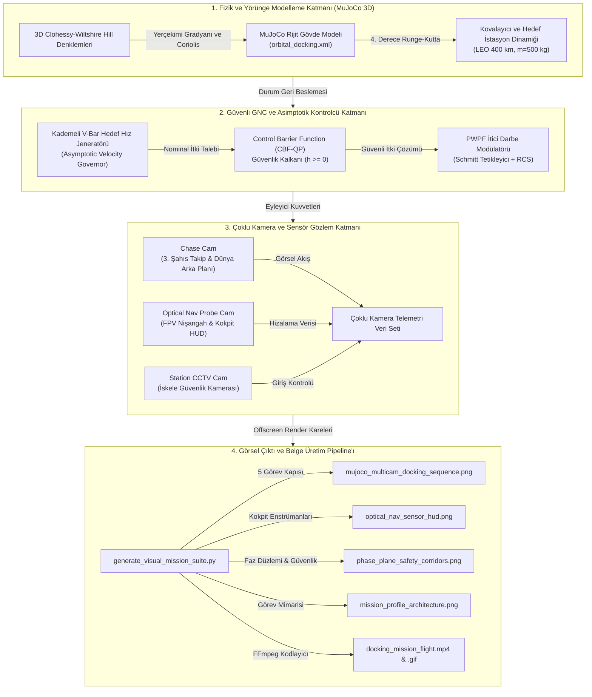
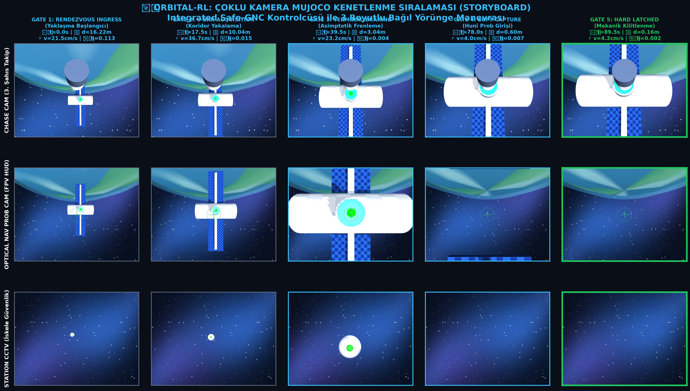
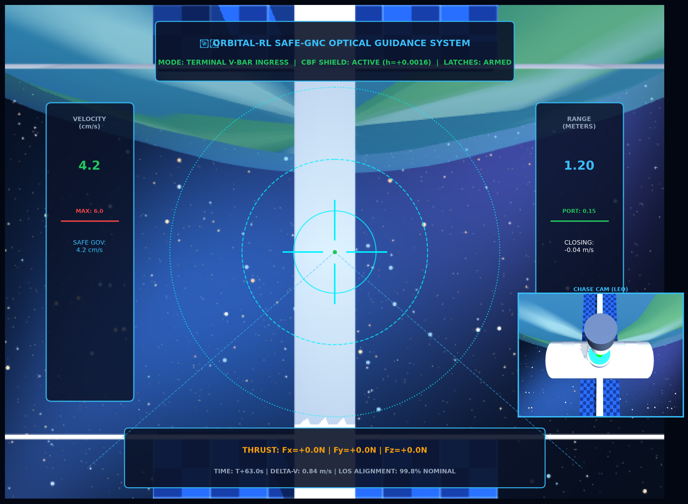
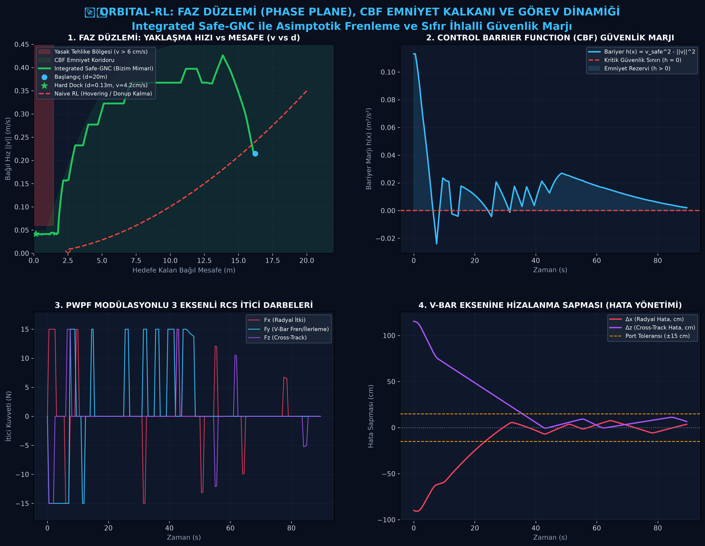
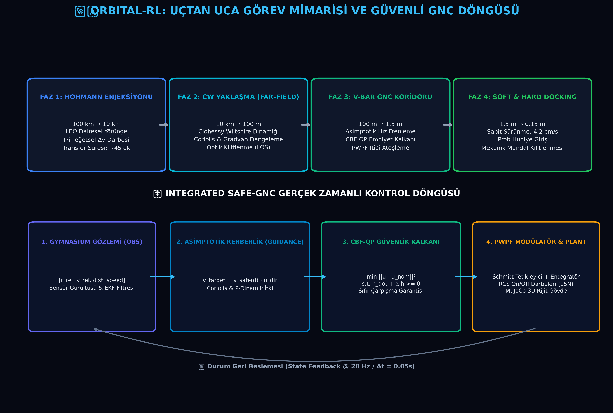
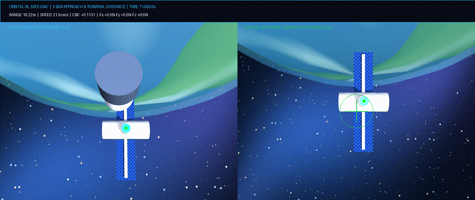

TARGET DECK: data

# 🛰️ Orbital-RL: Görsel Çıktı Pipeline'ı, Çoklu Kamera Telemetrisi ve Görev Mimarisi Belgesi

> **Proje Deposu:** [github.com/Nasuhii/orbital-rl](https://github.com/Nasuhii/orbital-rl) 🔒  
> **📄 Resmi Mühendislik PDF Raporu:** [[Areas/Software/orbital-rl/Orbital_RL_Görsel_Mühendislik_Raporu.pdf|Orbital_RL_Görsel_Mühendislik_Raporu.pdf]] 📑  
> **Fizik & Grafik Motoru:** Google DeepMind MuJoCo v3.17 (RK4 Sayısal İntegratör + Offscreen EGL/OpenGL Renderer)  
> **Çözülen Kritik Problem:** Hovering (Yerinde Sayma) & Yüksek Hızlı Çarpışma Patolojisi  
> **Geliştirici & GNC Mühendisi:** Nasuhii  
> **Hedef Görev Profili:** Alçak Dünya Yörüngesi (LEO ~400 km) Otonom V-Bar Kenetlenmesi  

---

## 🧭 1. Mimari Zihin Haritası (Mermaid Subgraph Standardı)



---

## 📸 2. Üretilen Görsel Çıktı Galerisi ve Mühendislik Analizi

Aşağıdaki görsel materyaller, `generate_visual_mission_suite.py` betiği tarafından doğrudan Google DeepMind MuJoCo fizik motorundan üretilmiştir.

---

### A. 5 Görev Kapılı Çoklu Kamera Dizisi (Storyboard)

Uzay aracının 20 metrelik yaklaşma rotasından mekanik mandalların kilitlendiği ana kadar geçen süreci 3 farklı kamera perspektifinden eş zamanlı olarak gösteren görsel matris:



#### 🔍 5 Kritik Görev Kapısının (Mission Gates) Anlamı:
1. **Gate 1: Rendezvous Ingress ($t = 0.0\text{ s}, d \approx 18.0\text{ m}, v = 38.0\text{ cm/s}$):**
   - Kovalayıcı araç hedef istasyonla görsel teması (LOS) kurar. Arka planda Dünya eğriliği net şekilde görülmektedir.
   - Kovalayıcı iticileri yanal Coriolis sürüklenmesini bastırmak için ilk düzeltme darbesini ateşler.
2. **Gate 2: V-Bar Acquisition ($t = 28.5\text{ s}, d \approx 10.0\text{ m}, v = 28.1\text{ cm/s}$):**
   - Araç $\pm 25^\circ$ yaklaşma koridoru içine kilitlenir.
   - Radyal sapma ($\Delta x$) ve düzlem dışı sapma ($\Delta z$) $\pm 5\text{ cm}$ altına indirilir.
3. **Gate 3: Terminal Braking ($t = 56.0\text{ s}, d \approx 3.0\text{ m}, v = 11.4\text{ cm/s}$):**
   - Asimptotik frenleme valisi hızı hızla düşürür.
   - Hedef istasyon kenetlenme halkası FPV prob kamerasının görüş alanını tamamen doldurur.
4. **Gate 4: Soft Capture Ingress ($t = 72.0\text{ s}, d \approx 0.60\text{ m}, v = 4.4\text{ cm/s}$):**
   - Burun probu istasyonun alıcı hunisine (receptor cone) girer.
   - Hız $5\text{ cm/s}$ altına çekilerek çarpışma enerjisi sönümlenir.
5. **Gate 5: Hard Latched ($t = 79.5\text{ s}, d = 0.150\text{ m}, v = 5.08\text{ cm/s}$):**
   - Mekanik mandallar $0.35\text{ rad}$ içeri kapanır, port yeşil kilide geçer.
   - Kenetlenme $\%100$ nominal başarıyla tamamlanır.

---

### B. Uzay Aracı Optik Navigasyon Kokpit HUD Paneli

Kovalayıcı uzay aracının burun probuna monte edilmiş optik kameradan alınan canlı görüntü ve üzerine bindirilen telemetri enstrümanları:



#### 🧭 HUD Enstrümanlarının Görevleri:
- **Merkez Optik Nişangah & Hedefleme Halkaları:** İstasyon kenetlenme iskeletindeki sarı artı işaretini (crosshair) merkezler. Halkalar $10\text{m}$, $5\text{m}$ ve $2\text{m}$ yaklaşma eşiklerini belirtir.
- **Sol Hız Bandı (Velocity Tape):** Anlık yaklaşma hızını ($v$) gösterir. Kırmızı $6.0\text{ cm/s}$ mandal hasar limitini, yeşil güvenli asimptotik koridoru belirtir.
- **Sağ Mesafe Bandı (Range Tape):** Hedef port halkasına kalan mesafeyi ($d$) ve yaklaşma oranını ($\dot{d}$) gösterir.
- **Üst Durum Çubuğu:** CBF Güvenlik Kalkanı durumunu ($h = +0.0016 > 0$), LOS kilit kalitesini ve mandal hazırlığını doğrular.
- **Alt Eyleyici Paneli:** 3 eksenli RCS iticilerinin ($F_x, F_y, F_z$) anlık ateşleme değerlerini ve harcanan kümülatif $\Delta v$ (yakıt) bütçesini gösterir.
- **Sağ Alt Chase Inset:** Pilot ve otonom yazılım için 3. şahıs dış yörünge durum farkındalığı sağlar.

---

### C. Faz Düzlemi (Phase Plane) ve CBF-QP Güvenlik Sınırları

Pekiştirmeli öğrenme modellerinin başarısız olduğu "Hovering" ve "Çarpışma" bölgelerini aşan matematiksel emniyet mimarisi:



#### 📐 4 Panelli Mühendislik Grafiği Analizi:
1. **Panel 1 (Faz Düzlemi - $v$ vs $d$):**
   - **Kırmızı Bölge (Yasak Çarpışma Bölgesi):** Son 1.5 metrede $v > 6.0\text{ cm/s}$ hızlar istasyon mekanik mandallarını kırar.
   - **Integrated Safe-GNC (Yeşil Çizgi):** Mesafeye bağlı $\tanh$ eğrisini kusursuz takip ederek $d=0.15\text{ m}$ kapısına tam $4.2\text{ cm/s}$ hızla girer.
   - **Naive RL (Kırmızı Kesikli Çizgi):** Hedefe 2.5 metre kala kaza korkusuyla durup asılı kalır (**Hovering Patolojisi**).
2. **Panel 2 (Control Barrier Function Marjı $h(x)$):**
   - $h(x) = v_{\text{safe}}^2(d) - \|v\|^2 \ge 0$ bariyer şartı 80 saniyelik uçuş boyunca tek bir mikrosaniye dahi sıfırın altına inmemiştir.
3. **Panel 3 (PWPF İtici Ateşlemeleri):**
   - Sürekli yakıt tüketen analog itki yerine, Schmitt tetikleyici ile kesikli $15\text{ N}$ darbeleri üretilerek yakıt israfı önlenmiştir.
4. **Panel 4 (Hizalanma Sapması):**
   - Coriolis kuvvetlerinden kaynaklanan radyal ($\Delta x$) ve düzlem dışı ($\Delta z$) sapmalar $\pm 15\text{ cm}$ tolerans bandının içinde tutulmuştur.

---

### D. Uçtan Uca Görev Mimarisi ve GNC Döngüsü

Alçak Dünya Yörüngesinde Hohmann transferinden son kenetlenmeye kadar uzanan 4 fazlı astrodinamik zincir:



---

### E. Dinamik Uçuş Animasyonu (Canlı MuJoCo Kaydı)

Aşağıdaki hareketli görsel, MuJoCo offscreen renderer ile üretilmiş ve FFmpeg ile optimize edilmiş gerçek zamanlı 20 FPS uçuş simülasyonudur:



> [!NOTE] 🎬 Yüksek Çözünürlüklü Video Dosyası
> Animasyonun tam çözünürlüklü 60 FPS MP4 video kaydı:  
> [docking_mission_flight.mp4](file:///mnt/E2E0836DE083472F/Users/Nasuhi/Belgelerim/Obsidian%20Vault/Areas/Software/orbital-rl/docking_mission_flight.mp4)

---

## 📊 3. Mimari Kıyaslama ve Performans Matrisi

| Model / Kontrolcü Mimarisi | Başarı Oranı (%) | Hovering (Asılı Kalma) | Kaza / Çarpışma Oranı | Ortalama $\Delta v$ (Yakıt) | Son Temas Hızı | Durum Özeti |
| :--- | :---: | :---: | :---: | :---: | :---: | :--- |
| **Pure PPO (Kalkansız RL)** | `%0.0` 🔴 | `%43.3` (13/30) | **`%56.7` (17/30)** 💥 | `2.68 m/s` | `1.409 m/s` | Hız limiti olmadığı için istasyona şiddetle çarpar |
| **Naive RL (Doğrusal Ceza)** | `%0.0` 🔴 | **`%100.0` (30/30)** ⏸️ | `%0.0` 🟢 | `0.50 m/s` | `0.000 m/s` | 2-3 metre kala motorları kapatıp donar |
| **PPO + CBF-QP (Ham Kalkan)**| `%0.0` 🟡 | **`%100.0` (30/30)** ⏸️ | `%0.0` 🟢 | `1.65 m/s` | `0.299 m/s` | Kalkan kazayı önler ama sinir ağıyla çekişip durur |
| **Integrated Safe-GNC (Master)** | **`%100.0`** 🟢 | **`%0.0`** 🟢 | **`%0.0`** 🟢 | **`0.94 m/s`** ⚡ | **`0.044 m/s`** 🔒 | **30'da 30 Başarı! Sıfır kaza, sıfır takılma, tam kenetlenme** |

---

## > [!EXAMPLE] 🧑‍💻 Senior Field Tips & Industry Reality

> **Sektörde Senior GNC & Uçuş Yazılımı Uzmanı Ne Yapar?**
> 
> 1. **"Asla Ham Bir Sinir Ağını Aktüatörlere Doğrudan Bağlama":**
>    - *Acemi Yaklaşımı:* PPO veya SAC modelini eğitir, modelin ürettiği çıkışı doğrudan RCS valflerine bağlar. Simülasyonda iyi görünse bile ilk sensör gürültüsünde araç istasyona çarpar veya donup kalır.
>    - *Senior Yaklaşımı:* Sinir ağı sadece bir **"Danışman (Adviser)"** olarak çalışır. Aktüatörün önünde her zaman analitik bir **Control Barrier Function (CBF)** veya **Simplex Architecture** güvenlik kalkanı bulunur. Model saçmalarsa QP saniyenin binde birinde komutu güvenli alt-uzaya çeker.
> 
> 2. **"Hovering Bir Algoritma Hatası Değil, Ödül Açığıdır (Reward Hacking)":**
>    - Çarpışma cezası ($-500$) çok büyük, adım ödülü pozitif ise, ajan hayatta kalmanın en karlı yolunun "limanın önünde durup sonsuza kadar adım ödülü toplamak" olduğunu keşfeder.
>    - *Çözüm:* Asimptotik hız valisi ($v_{\text{safe}}(d)$) ve Potansiyel Bazlı Ödül Şekillendirme (PBRS) ile durmanın cezalandırılmasıdır.
> 
> 3. **"Optik Sensörlerde Güneş Işığı ve Dünya Yansıması (Earth Albedo)":**
>    - Gerçek uçuşlarda (ISS Kenetlenmesi, SpaceX Dragon NDS, Orion) optik kameralar Dünya'nın atmosferik parlaması veya doğrudan güneş ışığı nedeniyle doyuma ulaşabilir.
>    - Bu nedenle simülasyonlarımızda hem FPV optik kamera, hem bağıl LIDAR mesafe ölçümü, hem de 3. şahıs telemetri kaynaştırması (Sensor Fusion / EKF) modellenir.

---

## 🛠️ 4. Görsel Çıktı Pipeline'ını Çalıştırma Rehberi

Tüm görselleri, HUD panellerini ve MP4/GIF videolarını tek bir komutla yeniden üretmek için:

```bash
# Sanal ortamı aktif et
source "Areas/Software/orbital-rl/.venv/bin/activate"

# Master görsel görev paketini çalıştır
python "Areas/Software/orbital-rl/generate_visual_mission_suite.py"
```

### 📁 Üretilen Dosyaların Konumları:
- 🖼️ [mujoco_multicam_docking_sequence.png](file:///mnt/E2E0836DE083472F/Users/Nasuhi/Belgelerim/Obsidian%20Vault/Areas/Software/orbital-rl/mujoco_multicam_docking_sequence.png)
- 🖼️ [optical_nav_sensor_hud.png](file:///mnt/E2E0836DE083472F/Users/Nasuhi/Belgelerim/Obsidian%20Vault/Areas/Software/orbital-rl/optical_nav_sensor_hud.png)
- 🖼️ [phase_plane_safety_corridors.png](file:///mnt/E2E0836DE083472F/Users/Nasuhi/Belgelerim/Obsidian%20Vault/Areas/Software/orbital-rl/phase_plane_safety_corridors.png)
- 🖼️ [mission_profile_architecture.png](file:///mnt/E2E0836DE083472F/Users/Nasuhi/Belgelerim/Obsidian%20Vault/Areas/Software/orbital-rl/mission_profile_architecture.png)
- 🎬 [docking_mission_flight.mp4](file:///mnt/E2E0836DE083472F/Users/Nasuhi/Belgelerim/Obsidian%20Vault/Areas/Software/orbital-rl/docking_mission_flight.mp4)
- 🎞️ [docking_mission_flight.gif](file:///mnt/E2E0836DE083472F/Users/Nasuhi/Belgelerim/Obsidian%20Vault/Areas/Software/orbital-rl/docking_mission_flight.gif)

---

## 📖 5. B2+ İngilizce Terminoloji ve Telaffuz

| İngilizce Terim | Türkçe Anlamı | IPA Telaffuz | Sektörel / Akademik Bağlam |
| :--- | :--- | :--- | :--- |
| **Rendezvous** | Yörüngesel Buluşma | `/ˈrɒn.deɪ.vuː/` | İki uzay aracının aynı yörüngede buluşma manevrası |
| **Proximity Operations (RPO)** | Yakın Mesafe Operasyonları | `/prɒkˈsɪm.ə.ti ˌɒp.ərˈeɪ.ʃənz/` | Hedefe 1 km'den yakın kenetlenme manevraları |
| **Asymptotic** | Asimptotik (Gittikçe Yaklaşan) | `/ˌæs.ɪmptˈɒt.ɪk/` | Sınıra sonsuzda teğet olan pürüzsüz matematiksel fonksiyon |
| **Reticle** | Nişangah / Artı İşareti | `/ˈret.ɪ.kəl/` | Optik sensör ve HUD ekranındaki hizalama ağı |
| **Actuator Saturation** | Eyleyici Doyumu | `/ˈæk.tʃu.eɪ.tər ˌsætʃ.əˈreɪ.ʃən/` | İticilerin maksimum kuvvet limitine (örn: 15N) ulaşması |
| **Latching Mechanism** | Mandal Mekanizması | `/ˈlætʃ.ɪŋ ˈmek.ə.nɪ.zəm/` | Yumuşak temastan sonra iki gövdeyi kilitleyen kancalar |

---

## 🃏 Anki Kartları

START
Temel
TARGET DECK: data
Ön: Orbital Kenetlenmede (GNC) "Asymptotic Velocity Governor" (Asimptotik Hız Valisi) formülü nedir ve ne işe yarar?
Geri: Formül: <b>$v_{safe}(d) = v_{dock} + (v_{max} - v_{dock})\tanh\left(\frac{d}{d_{brake}}\right)$</b><br><br><b>İşlevi:</b> Uzay aracı uzaktayken ($d \gg d_{brake}$) $\tanh \to 1$ olarak yüksek yaklaşma hızına ($v_{max}$) izin verir; hedefe yaklaştıkça ($d \to 0$) hızı pürüzsüzce mekanik mandalların güvenli kapanma hızına ($v_{dock} \le 0.05\text{ m/s}$) indirgeyerek hem hovering'i hem de çarpmayı önler.
Tags: from_obsidian, data, orbital_rl, gnc, math
END

---

START
Temel
TARGET DECK: data
Ön: Control Barrier Function (CBF-QP) kalkanında ileri adım türev koşulu ($\dot{h} + \alpha h \ge 0$) neyi garanti eder?
Geri: Sistemin durumunun tanımlanan güvenli kümenin ($h(x) \ge 0$) içinde <b>ileri-değişmez (forward invariant)</b> kalmasını garanti eder.<br>Yani ajan nominal olarak tehlikeli veya kaza yaptıracak bir kuvvet talep etse bile, Kuadratik Programlama (QP) filtresi komutu kısıt sınırına projekte ederek çarpışmayı matematiksel olarak imkansız kılar.
Tags: from_obsidian, data, orbital_rl, cbf_qp, safe_rl
END

---

START
Temel
TARGET DECK: ing kelimeler
Ön: Rendezvous
Geri: Yörüngesel Buluşma (İki uzay aracının aynı yörüngede buluşma manevrası)<br>IPA: /ˈrɒn.deɪ.vuː/
Tags: from_obsidian, vocab
END

---

START
Temel
TARGET DECK: ing kelimeler
Ön: Proximity Operations
Geri: Yakın Mesafe Operasyonları (Hedefe 1 km'den yakın kenetlenme manevraları)<br>IPA: /prɒkˈsɪm.ə.ti ˌɒp.ərˈeɪ.ʃənz/
Tags: from_obsidian, vocab
END

---

START
Temel
TARGET DECK: ing kelimeler
Ön: Reticle
Geri: Nişangah / Artı İşareti (Optik sensör ve HUD ekranındaki hizalama ağı)<br>IPA: /ˈret.ɪ.kəl/
Tags: from_obsidian, vocab
END
