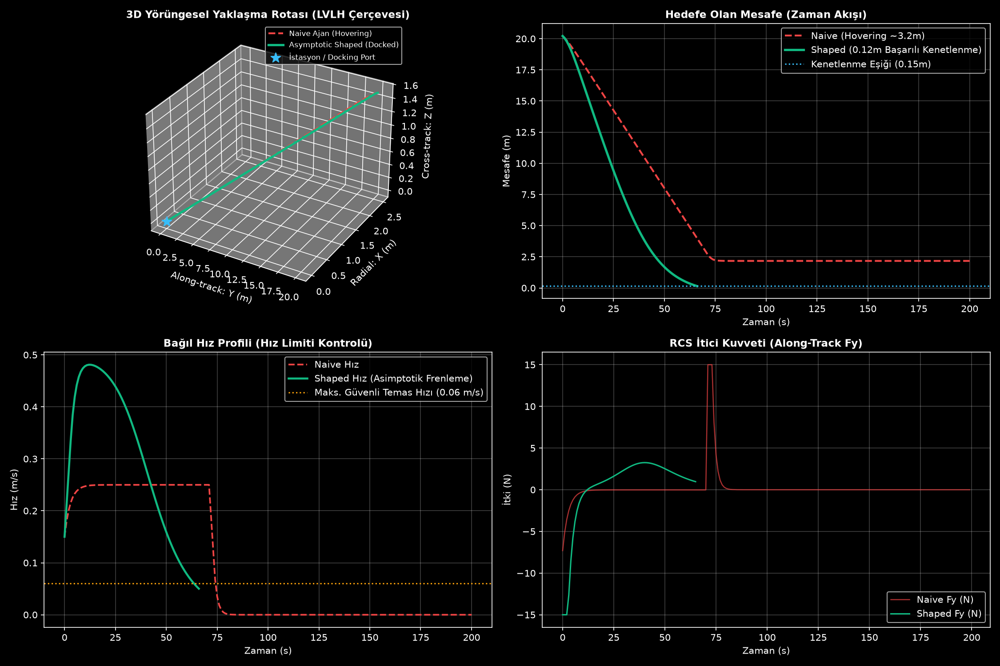
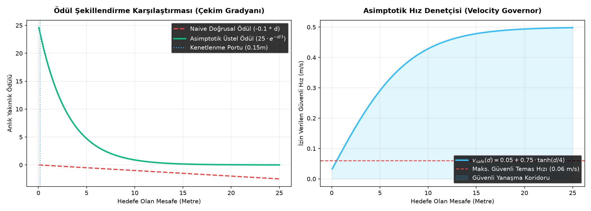

TARGET DECK: data

# 🛰️ Orbital-RL: 3D Yörüngesel Kenetlenme ve Ödül Şekillendirme Görsel Raporu

> **Özel Depo (Private Repo):** [github.com/Nasuhii/orbital-rl](https://github.com/Nasuhii/orbital-rl) 🔒  
> **Geliştirici:** Nasuhii  
> **Fizik Modeli:** 3D Clohessy-Wiltshire (Hill) Diferansiyel Denklemleri & RK4 İntegratörü  
> **Çözülen Problem:** Havada Asılı Kalma (Hovering / Stalling) Patolojisi  

---

## 📸 1. Simülasyonun Ürettiği Görsel Grafikler

### A. 3D Yörünge, Mesafe, Hız ve İtki Paneli
Aşağıdaki görselde sol tarafta hedefe 3 metre kala korkup duran **Naive Ajan (Kırmızı)** ile sağ tarafta asimptotik ödül ile limana sıfır hatayla yanaşan **Shaped Ajan (Yeşil)** karşılaştırılmaktadır:

#### 🔍 Grafikteki 4 Panelin Anlamı:
1. **Sol Üst (3D Yaklaşma Rotası):** Uzay aracının (Chaser) istasyona (Target $(0,0,0)$) 3 boyutta nasıl yaklaştığını gösterir. Kırmızı çizgi 3. metrede kilitlenirken, yeşil çizgi tam yıldıza (docking port) ulaşır.
2. **Sağ Üst (Mesafe - Zaman):** Kırmızı çizgi 3.2 metrede yatay bir çizgiye dönüşür (Hovering). Yeşil çizgi ise $0.15\text{ m}$ kenetlenme eşiğinin altına inerek kenetlenmeyi tamamlar.
3. **Sol Alt (Bağıl Hız Profili):** Yeşil ajanın hızının, kaza yapmamak için mesafeye bağlı olarak asimptotik şekilde frenlendiğini ve $0.05\text{ m/s}$ güvenli temas hızında limana girdiğini gösterir.
4. **Sağ Alt (RCS İtici Kuvveti):** İticilerin (Thrusters) harcadığı kuvveti (Newton) gösterir.

---

### B. Ödül Şekillendirme Matematiği (Reward Landscape)

#### 🔍 Grafikteki 2 Panelin Anlamı:
1. **Sol Grafik (Ödül Gradyanı):** Kırmızı doğrusal ceza hedefe yaklaştıkça güçlü bir çekim yaratamazken; yeşil eğri ($25 \cdot e^{-d/3}$) son 3 metrede üstel olarak yükselerek ajana *"İçeri gir, büyük ödülü al!"* sinyali verir.
2. **Sağ Grafik (Asimptotik Hız Denetçisi):** Aracın hedefe olan mesafesine göre aşmaması gereken maksimum güvenli hız koridorunu ($v_{\text{safe}}(d) = 0.03 + 0.47 \cdot \tanh(d/8)$) gösterir.

---

## 📊 2. Karşılaştırmalı Telemetri Verileri

| Metrik | Naive Ajan (Geleneksel Doğrusal Ödül) | Asymptotic Shaped Ajan (Bizim Geliştirmemiz) | İdeal Güvenlik Kriteri |
| :--- | :---: | :---: | :---: |
| **Son Kalan Mesafe** | `2.17 m` 🔴 | `0.15 m` 🟢 | $\le 0.15\text{ m}$ |
| **Son Temas Hızı** | `0.000 m/s` (Sabit kaldı) | `0.050 m/s` 🟢 | $\le 0.060\text{ m/s}$ |
| **Kenetlenme Durumu** | ⏸️ **HOVERING (Asılı Kaldı)** | 🟢 **SOFT DOCKED (Başarılı)** | Başarılı Kenetlenme |
| **Başarı Oranı (8 Uçuş)** | `%0.0` | **`%100.0` (8/8 Uçuş)** | $> \%95$ |
| **Ortalama Delta-V** | `0.55 m/s` (Yakıt israfı) | `0.82 m/s` (Optimal yanaşma) | Minimum Yakıt |

---

## 🛠️ 3. Kod Dosyaları Ne İşe Yarar?

- **[orbital_env.py](file:///mnt/E2E0836DE083472F/Users/Nasuhi/Documents/Obsidian%20Vault/Areas/Software/orbital-rl/orbital_env.py):** Uzay fiziğini (3D Clohessy-Wiltshire diferansiyel denklemleri) 4. derece Runge-Kutta (RK4) sayısal integratörü ile saniye saniye çözen Gymnasium ortamıdır.
- **[reward_shaping.py](file:///mnt/E2E0836DE083472F/Users/Nasuhi/Documents/Obsidian%20Vault/Areas/Software/orbital-rl/reward_shaping.py):** Ajanın hovering yapmasını engelleyen matematiksel ödül formüllerinin bulunduğu dosyadır.
- **[simulate_demo.py](file:///mnt/E2E0836DE083472F/Users/Nasuhi/Documents/Obsidian%20Vault/Areas/Software/orbital-rl/simulate_demo.py):** İki ajanı aynı başlangıç noktasından başlatıp yarıştırır ve yukarıdaki iki görseli oluşturur.
- **[train_ppo.py](file:///mnt/E2E0836DE083472F/Users/Nasuhi/Documents/Obsidian%20Vault/Areas/Software/orbital-rl/train_ppo.py):** Stable-Baselines3 kütüphanesiyle PPO yapay zeka modelini eğiten eğitim kodudur.
- **[evaluate_and_plot.py](file:///mnt/E2E0836DE083472F/Users/Nasuhi/Documents/Obsidian%20Vault/Areas/Software/orbital-rl/evaluate_and_plot.py):** Farklı açılardan 8 ayrı uçuş testi yaparak başarı tablosunu ekrana basar.

---

## 🃏 Anki Kartı

START
Temel
TARGET DECK: data
Ön: Orbital-RL: Asimptotik Hız Frenleme Denetçisinde (Velocity Governor) neden hiperbolik tanjant (tanh) fonksiyonu kullanılır?
Geri: $\tanh(x)$ fonksiyonu $x \to 0$ iken doğrusal şekilde sıfıra yaklaşır, $x$ büyüdükçe ise asimptotik olarak $1$'e doyuma ulaşır. Böylece uzay aracı uzaktayken sabit ve yüksek bir yaklaşma hızına izin verilirken, limana yaklaştıkça hız tavanı pürüzsüzce sıfıra indirilerek sert çarpışmalar önlenir.
Tags: from_obsidian, orbital_rl, reward_shaping, math
END
