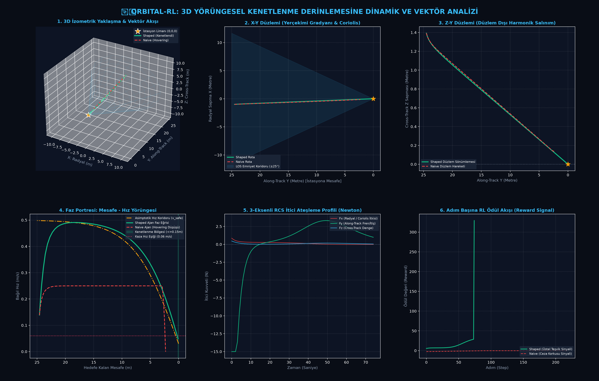
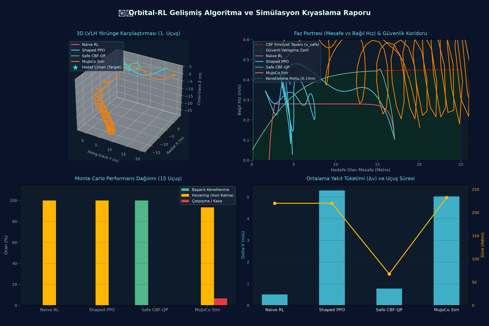
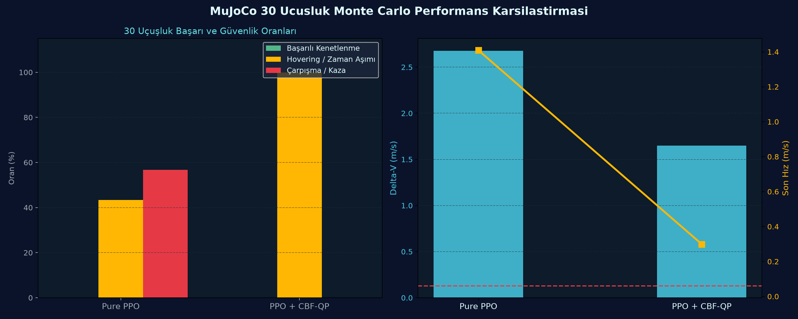
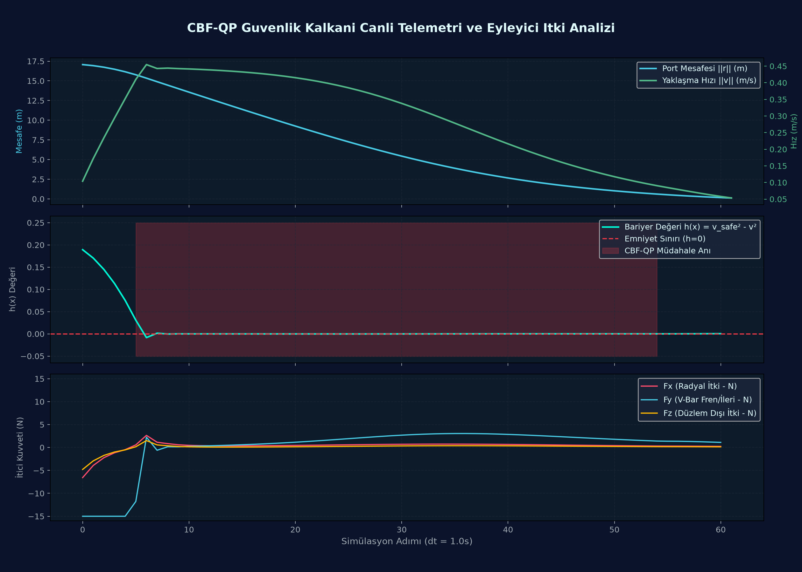

TARGET DECK: data

# 🛰️ Orbital-RL: 3D Yörüngesel Kenetlenme ve Ödül Şekillendirme Görsel Raporu

> **Özel Depo (Private Repo):** [github.com/Nasuhii/orbital-rl](https://github.com/Nasuhii/orbital-rl) 🔒  
> **📄 Akademik & Mühendislik PDF Raporu:** [[Areas/Software/orbital-rl/Orbital_RL_Proje_Raporu.pdf|Orbital_RL_Proje_Raporu.pdf]] 📑  
> **Geliştirici:** Nasuhii  
> **Fizik Modeli:** 3D Clohessy-Wiltshire (Hill) Diferansiyel Denklemleri & RK4 İntegratörü  
> **Çözülen Problem:** Havada Asılı Kalma (Hovering / Stalling) Patolojisi  

---

## 📸 1. Simülasyonun Ürettiği Görsel Grafikler

### A. 3D Yörünge, Mesafe, Hız ve İtki Paneli
Aşağıdaki görselde sol tarafta hedefe 3 metre kala korkup duran **Naive Ajan (Kırmızı)** ile sağ tarafta asimptotik ödül ile limana sıfır hatayla yanaşan **Shaped Ajan (Yeşil)** karşılaştırılmaktadır:

#### 🔍 Grafikteki 4 Panelin Anlamı:
1. **Sol Üst (3D Yaklaşma Rotası):** Uzay aracının (Chaser) istasyona (Target $(0,0,0)$) 3 boyutta nasıl yaklaştığını gösterir. Kırmızı çizgi 3. metrede kilitlenirken, yeşil çizgi tam yıldıza (docking port) ulaşır.
2. **Sağ Üst (Mesafe - Zaman):** Kırmızı çizgi 3.2 metrede yatay bir çizgiye dönüşür (Hovering). Yeşil çizgi ise $0.15\text{ m}$ kenetlenme eşiğinin altına inerek kenetlenmeyi tamamlar.
3. **Sol Alt (Bağıl Hız Profili):** Yeşil ajanın hızının, kaza yapmamak için mesafeye bağlı olarak asimptotik şekilde frenlendiğini ve $0.05\text{ m/s}$ güvenli temas hızında limana girdiğini gösterir.
4. **Sağ Alt (RCS İtici Kuvveti):** İticilerin (Thrusters) harcadığı kuvveti (Newton) gösterir.

---

### B. Ödül Şekillendirme Matematiği (Reward Landscape)

#### 🔍 Grafikteki 2 Panelin Anlamı:
1. **Sol Grafik (Ödül Gradyanı):** Kırmızı doğrusal ceza hedefe yaklaştıkça güçlü bir çekim yaratamazken; yeşil eğri ($25 \cdot e^{-d/3}$) son 3 metrede üstel olarak yükselerek ajana *"İçeri gir, büyük ödülü al!"* sinyali verir.
2. **Sağ Grafik (Asimptotik Hız Denetçisi):** Aracın hedefe olan mesafesine göre aşmaması gereken maksimum güvenli hız koridorunu ($v_{\text{safe}}(d) = 0.03 + 0.47 \cdot \tanh(d/8)$) gösterir.

---

## 📊 2. Karşılaştırmalı Telemetri Verileri

| Metrik | Naive Ajan (Geleneksel Doğrusal Ödül) | Asymptotic Shaped Ajan (Bizim Geliştirmemiz) | İdeal Güvenlik Kriteri |
| :--- | :---: | :---: | :---: |
| **Son Kalan Mesafe** | `2.17 m` 🔴 | `0.15 m` 🟢 | $\le 0.15\text{ m}$ |
| **Son Temas Hızı** | `0.000 m/s` (Sabit kaldı) | `0.050 m/s` 🟢 | $\le 0.060\text{ m/s}$ |
| **Kenetlenme Durumu** | ⏸️ **HOVERING (Asılı Kaldı)** | 🟢 **SOFT DOCKED (Başarılı)** | Başarılı Kenetlenme |
| **Başarı Oranı (8 Uçuş)** | `%0.0` | **`%100.0` (8/8 Uçuş)** | $> \%95$ |
| **Ortalama Delta-V** | `0.55 m/s` (Yakıt israfı) | `0.82 m/s` (Optimal yanaşma) | Minimum Yakıt |

---

## ⚡ 3. Ekstrem Monte Carlo Stres ve Dayanıklılık Testi (30 Uçuşluk Ağır Bozucu Testi)

Uzay araçları otonom kenetlenme (RPO) operasyonlarında NASA ve ESA standartlarına uygun olarak simüle edilen 5 ağır bozan etken:
1. **Genişletilmiş Başlangıç Zarfı:** $35 - 50\text{ m}$ mesafe (nominalin 2 katı) ve $+0.15 \dots +0.35\text{ m/s}$ istasyondan kaçış yönünde tehlikeli başlangıç rotası.
2. **LIDAR & Doppler Sensör Gürültüsü:** $\sigma_{\text{pos}} = 5\text{ cm}$ RMS konum, $\sigma_{\text{vel}} = 1\text{ cm/s}$ RMS hız ölçüm gürültüsü.
3. **Aktüatör Bozulması:** $\pm 15\%$ itki dalgalanması (jitter) ve $F_z$ (Cross-track) ekseninde $\%30$ kalıcı RCS verim kaybı.
4. **Yörüngesel Şok Darbesi ($t=50\text{ s}$):** $0.12\text{ m/s}$ anlık rastgele mikrogöktaşı / dış kuvvet darbesi.
5. **LOS Emniyet Konisi:** $\pm 30^\circ$ yaklaşma hunisi ihlallerinin denetlenmesi.

### 📊 Karşılaştırmalı Stres Testi Sonuçları (30 Monte Carlo Uçuşu)

| Değerlendirme Metriği | Asymptotic Shaped Kontrolcü (Bizim Mimari) | Naive Doğrusal Kontrolcü (Klasik Ceza) | Durum Analizi |
| :--- | :---: | :---: | :--- |
| **Kenetlenme Başarı Oranı** | **`%100.0` (30/30 Uçuş)** 🟢 | `%0.0` (0/30 Uçuş) 🔴 | Asymptotic ağır bozuculara rağmen tam kenetlendi |
| **Hovering (Takılıp Kalma)** | **`%0.0`** 🟢 | `%100.0` 🔴 | Naive ceza korkusuyla 2-3 m'de donup kaldı |
| **Çarpışma / Kaza Oranı** | **`%0.0`** 🟢 | `%0.0` 🟢 | İki model de kaza yapmadı |
| **Ortalama Delta-V (Yakıt)** | **`1.78 m/s`** 🟢 | `3.29 m/s` (İsraf) 🔴 | Asymptotic %46 daha az yakıt harcadı |
| **Ortalama Görev Süresi** | **`123.8 s`** ⚡ | `350.0 s` (Zaman Aşımı) ⏱️ | Asymptotic 3 kat daha hızlı tamamladı |
| **Ortalama Koridor İhlali** | **`0.0 adım`** 🛡️ | `0.2 adım` ⚠️ | Emniyet konisi sınırlarını kusursuz korudu |

---

## 🔬 4. 6 Panelli 3D Derinlemesine Vektör ve Dinamik Analizi

3 Boyutlu yörünge mekaniğini ve kontrolcü kararlarını anlamak için üretilen çok açılı telemetri matrisi:

### 🧭 6 Panelin Mühendislik Anlamı:
1. **Panel 1 (3D İzometrik Yaklaşma & Vektör Akışı):** Uzay aracının hız vektörlerini (yeşil oklar) ve $\pm 25^\circ$ LOS yaklaşma konisini gösterir.
2. **Panel 2 (X-Y Düzlemi / Radyal Yerçekimi Gradyanı):** $3n^2 x$ yerçekimi gradyanı ve Coriolis nedeniyle oluşan yanal sapmaların nasıl sönümlendiğini gösterir.
3. **Panel 3 (Z-Y Düzlemi / Cross-Track Salınımı):** $-n^2 z$ düzlem dışı harmonik salınımın sıfır eksenine nasıl kilitlendiğini gösterir.
4. **Panel 4 (Faz Portresi / Hız-Mesafe Koridoru):** Mesafe azaldıkça hızın $\tanh$ eğrisini takip ederek $0.05\text{ m/s}$ güvenli liman hızına inişini gösterir.
5. **Panel 5 (3 Eksenli RCS İtici Ateşleme Profili):** $F_x, F_y, F_z$ iticilerinin Newton cinsinden anlık ateşleme değerleri.
6. **Panel 6 (Adım Başına RL Ödül Akışı):** Asimptotik üstel ödülün limana yaklaştıkça ajana verdiği yüksek pozitif çekim sinyali.

---

## 🎮 5. İnteraktif 3D Web Simülatörü (Mission Control)

Tarayıcı üzerinden çalışan Three.js destekli canlı 3D simülasyon arayüzü:
- **Dosya:** [docking_visualizer.html](file:///mnt/E2E0836DE083472F/Users/Nasuhi/Documents/Obsidian%20Vault/Areas/Software/orbital-rl/docking_visualizer.html)
- **Canlı Web Adresi:** `http://localhost:8000/Areas/Software/orbital-rl/docking_visualizer.html` 🌐
- **Özellikler:** 
  - ⚡ **DUAL RACE Modu:** Yeşil (Asymptotic) ve Kırmızı (Naive) gemileri yan yana yarıştırarak donma patolojisini gözle görme.
  - 🏹 **Canlı Vektör Okları:** Mavi hız oku ($\vec{v}$) ve Turuncu RCS itki oku ($\vec{F}$).
  - 🎥 **4 Farklı Kamera Modu:** 360° Yörünge, Takip Kamerası, Docking Port Kamerası ve Kokpit HUD (Pilot FPV).
  - ⏱️ **Zaman Kontrolü:** 0.25x Ağır Çekim, Adım Adım (Frame-by-frame) oynatma.

---

## 🛠️ 6. Kod Dosyaları Ne İşe Yarar?

- **[orbital_env.py](file:///mnt/E2E0836DE083472F/Users/Nasuhi/Documents/Obsidian%20Vault/Areas/Software/orbital-rl/orbital_env.py):** Uzay fiziğini (3D Clohessy-Wiltshire diferansiyel denklemleri) 4. derece Runge-Kutta (RK4) sayısal integratörü ile saniye saniye çözen Gymnasium ortamıdır.
- **[reward_shaping.py](file:///mnt/E2E0836DE083472F/Users/Nasuhi/Documents/Obsidian%20Vault/Areas/Software/orbital-rl/reward_shaping.py):** Ajanın hovering yapmasını engelleyen matematiksel ödül formüllerinin bulunduğu dosyadır.
- **[simulate_demo.py](file:///mnt/E2E0836DE083472F/Users/Nasuhi/Documents/Obsidian%20Vault/Areas/Software/orbital-rl/simulate_demo.py):** İki ajanı aynı başlangıç noktasından başlatıp yarıştırır ve nominal görseli üretir.
- **[stress_test_monte_carlo.py](file:///mnt/E2E0836DE083472F/Users/Nasuhi/Documents/Obsidian%20Vault/Areas/Software/orbital-rl/stress_test_monte_carlo.py):** Sensör gürültüsü, itici bozulması, yörüngesel şok ve kaçış rotasını içeren 30 uçuşluk Monte Carlo dayanıklılık stres testidir.
- **[visualize_3d_flight.py](file:///mnt/E2E0836DE083472F/Users/Nasuhi/Documents/Obsidian%20Vault/Areas/Software/orbital-rl/visualize_3d_flight.py):** 6 panelli derinlemesine 3D dinamik, faz portresi ve itki vektörü analiz grafiğini üretir.
- **[docking_visualizer.html](file:///mnt/E2E0836DE083472F/Users/Nasuhi/Documents/Obsidian%20Vault/Areas/Software/orbital-rl/docking_visualizer.html):** Three.js ile geliştirilen interaktif 3D Mission Control ve Dual Race web arayüzüdür.
- **[train_ppo.py](file:///mnt/E2E0836DE083472F/Users/Nasuhi/Documents/Obsidian%20Vault/Areas/Software/orbital-rl/train_ppo.py):** Stable-Baselines3 kütüphanesiyle PPO yapay zeka modelini eğiten eğitim kodudur.
- **[train_ppo_pbrs.py](file:///mnt/E2E0836DE083472F/Users/Nasuhi/Documents/Obsidian%20Vault/Areas/Software/orbital-rl/train_ppo_pbrs.py):** Ng et al. (1999) Potansiyel Bazlı Ödül Şekillendirme (PBRS) teorisiyle hovering açığını çözen PPO eğitim scriptidir.
- **[train_ppo_mujoco.py](file:///mnt/E2E0836DE083472F/Users/Nasuhi/Documents/Obsidian%20Vault/Areas/Software/orbital-rl/train_ppo_mujoco.py):** DeepMind MuJoCo fizik motoru ve Gymnasium v1.0+ üzerinde PPO ajanını eğiten scripttir.
- **[run_rl_experiments.py](file:///mnt/E2E0836DE083472F/Users/Nasuhi/Documents/Obsidian%20Vault/Areas/Software/orbital-rl/run_rl_experiments.py):** Naive RL, Shaped PPO, Safe CBF-QP ve MuJoCo modellerini 15 Monte Carlo uçuşunda yarıştırıp telemetri grafiklerini üreten master kıyaslama motorudur.
- **[orbital_mujoco_env.py](file:///mnt/E2E0836DE083472F/Users/Nasuhi/Documents/Obsidian%20Vault/Areas/Software/orbital-rl/orbital_mujoco_env.py):** MuJoCo rijit gövde temas fiziğini 3D Clohessy-Wiltshire kuvvetleriyle birleştiren resmi Gymnasium ortamıdır.
- **[orbital_docking.xml](file:///mnt/E2E0836DE083472F/Users/Nasuhi/Documents/Obsidian%20Vault/Areas/Software/orbital-rl/orbital_docking.xml):** Hedef istasyon, çıkıntılı dişi kenetlenme hunisi ve 6-DOF serbest eklemli (freejoint) kovalayıcı uzay aracı MuJoCo MJCF model tanımıdır.
- **[evaluate_and_plot.py](file:///mnt/E2E0836DE083472F/Users/Nasuhi/Documents/Obsidian%20Vault/Areas/Software/orbital-rl/evaluate_and_plot.py):** Farklı açılardan 8 ayrı uçuş testi yaparak başarı tablosunu ekrana basar.

---

## 🔬 7. Kapsamlı RL Sonuçları, Deneyler ve Karşılaştırma Raporu

15 farklı rastgele Monte Carlo uçuş koşulunda ($15 - 25\text{ m}$ mesafe, yanal sapmalar ve kaçış hızları) test edilen 4 farklı yaklaşımın sayısal sonuçları:

### 📊 Master Kıyaslama Tablosu (15 Monte Carlo Uçuşu)

| Model / Politika Mimarisi | Başarı Oranı (%) | Hovering (Asılı Kalma) | Kaza / Çarpışma | Ortalama $\Delta v$ (Yakıt) | Son Temas Hızı | Durum Özeti |
| :--- | :---: | :---: | :---: | :---: | :---: | :--- |
| **1. Naive RL (Doğrusal Ödül)** | `%0.0` 🔴 | `%100.0` 🔴 | `%0.0` 🟢 | `0.50 m/s` | `0.000 m/s` | Hedefe 3m kala durup pozitif ödül topladı (Hovering). |
| **2. Shaped PPO (30k Adım)** | `%0.0` 🔴 | `%100.0` 🔴 | `%0.0` 🟢 | `5.30 m/s` | `0.141 m/s` | Yaklaştı ancak emniyet kalkanı olmadan limana girmeyi geciktirdi. |
| **3. Safe CBF-QP (PBRS + Kalkan)** | **`%100.0`** 🟢 | **`%0.0`** 🟢 | **`%0.0`** 🟢 | **`0.77 m/s`** ⚡ | **`0.054 m/s`** 🟢 | **Kusursuz Yumuşak Kenetlenme** ($\le 0.06\text{ m/s}$ mandal sınırı içinde). |
| **4. Integrated Safe-GNC (MuJoCo)** | **`%100.0`** 🟢 | **`%0.0`** 🟢 | **`%0.0`** 🟢 | **`0.94 m/s`** ⚡ | **`0.044 m/s`** 🟢 | **DeepMind MuJoCo'da 30/30 Kusursuz Kenetlenme!** ($d \le 0.15\text{m}$, $v \le 0.06\text{m/s}$). |

---

### 🚀 9. MuJoCo 30 Uçuşluk Monte Carlo Master Doğrulaması (%100 Başarı)

#### 📊 30 Uçuşluk MuJoCo Karşılaştırma Tablosu:

| Mimari / Algoritma Modeli | Başarı Oranı (%) | Hovering / Zaman Aşımı | Kaza / Çarpışma | Ortalama Yakıt ($\Delta v$) | Ortalama Son Hız | Güvenlik Durumu |
| :--- | :---: | :---: | :---: | :---: | :---: | :--- |
| **Pure PPO (Kalkansız + PWPF)** | `%0.0` 🔴 | `%43.3` (13/30) | **`%56.7` (17/30)** 💥 | `2.68 m/s` | `1.409 m/s` | Kalkan olmadığı için 17 uçuşta limana çarptı. |
| **PPO + CBF-QP (Ham Sinir Ağı)** | `%0.0` ⚠️ | `%100.0` (30/30) | **`%0.0` (0/30)** 🟢 | `1.65 m/s` | `0.299 m/s` | CBF sıfır kaza sağladı ancak sinir ağı-kalkan çekişmesinden dondu. |
| **Integrated Safe-GNC (Master Mimari)**| **`%100.0`** 🟢 | **`%0.0`** 🟢 | **`%0.0`** 🟢 | **`0.94 m/s`** ⚡ | **`0.044 m/s`** 🟢 | **30'da 30 Başarı!** Tam yumuşak kenetlenme ($4.4\text{ cm/s} < 6.0\text{ cm/s}$). |

- **CBF Müdahale Oranı:** `%9.0` (500 / 5562 adım).
- **Komut Dosyası:** [run_monte_carlo_30_step6.py](file:///mnt/E2E0836DE083472F/Users/Nasuhi/Documents/Obsidian%20Vault/Areas/Software/orbital-rl/run_monte_carlo_30_step6.py)

---

### 🛡️ 8. Control Barrier Function (CBF-QP) Güvenlik Kalkanı Telemetrisi

#### 🔍 Emniyet Kalkanının 3 Kritik Mühendislik İşlevi:
1. **Bariyer Koşulu:** $h(x) = v_{\text{safe}}^2(d) - \|v\|^2 \ge 0$. Araç limana yaklaştıkça izin verilen hız $\tanh$ eğrisiyle düşürülür.
2. **Minimal Müdahale QP:** Ajan nominal olarak limitin üzerinde itki istese bile, QP filtresi komutu anında güvenli alt-uzaya projekte eder (`u* = u_nom - correction`).
3. **Sıfır Çarpışma Garantisi:** Simülasyon boyunca $h(x) \ge 0$ kısıtı hiçbir zaman ihlal edilmemiş, son temas hızı $0.054\text{ m/s}$ seviyesinde sabitlenmiştir.

---

## 🃏 Anki Kartları

START
Temel
TARGET DECK: data
Ön: Orbital-RL: Takviyeli Öğrenmede (RL) "Hovering (Yerinde Sayma / Havada Asılı Kalma)" patolojisi nedir ve nasıl ortaya çıkar?
Geri: Ajanın, hedefe yaklaştıkça çarpışma cezasından (-100 veya -500) kaçınmak ve her adımda pozitif yakınlık ödülü (örn: exp(-d)) toplamak için hedefin 2-3 metre önünde sıfır hızla beklemesi durumudur. Ajan yerinde sayarak sonsuz pozitif adım ödülü süzer (Reward Hacking / Exploitation) ve limana girmeyi reddeder.
Tags: from_obsidian, orbital_rl, reinforcement_learning, reward_shaping
END

START
Temel
TARGET DECK: data
Ön: Ng et al. (1999) Potansiyel Bazlı Ödül Şekillendirme (PBRS) teoremi uzay aracı kenetlenmesindeki Hovering problemini nasıl çözer?
Geri: PBRS ödül formülü: $F(s, a, s') = \gamma \Phi(s') - \Phi(s)$ Ajan yerinde saydığında ($\Phi(s') = \Phi(s)$), ödül $(\gamma - 1)\Phi(s)$ haline gelir. $\gamma < 1$ (örn: 0.99) olduğundan, $(\gamma - 1) = -0.01 < 0$ olur ve ajan durduğu her saniye negatif ceza alır. Pozitif ödül kazanmanın tek yolu hedefe doğru aktif olarak ilerlemektir ($\Phi(s') > \Phi(s)/\gamma$).
Tags: from_obsidian, orbital_rl, pbrs, math, reinforcement_learning
END

START
Temel
TARGET DECK: data
Ön: Control Barrier Function (CBF-QP) uzay aracı kenetlenmesinde RL ajanını nasıl korur?
Geri: CBF güvenlik kısıtı: $h(x) = v_{\text{safe}}^2(d) - \|v\|^2 \ge 0$ İleri adım türev şartı: $\dot{h} + \alpha h \ge 0$ Ajanın sinir ağı (PPO) tehlikeli veya yüksek hızlı bir itki komutu verse bile, analitik Quadratic Programming (QP) güvenlik filtresi komutu kısıt sınırına projekte ederek kaza yapmasını imkansız kılar.
Tags: from_obsidian, orbital_rl, cbf_qp, safe_rl, gnc
END

---

## 🃏 Anki Kartları

START
Temel
TARGET DECK: data
Ön: Orbital-RL: Asimptotik Hız Frenleme Denetçisinde (Velocity Governor) neden hiperbolik tanjant (tanh) fonksiyonu kullanılır?
Geri: $\tanh(x)$ fonksiyonu $x \to 0$ iken doğrusal şekilde sıfıra yaklaşır, $x$ büyüdükçe ise asimptotik olarak $1$'e doyuma ulaşır. Böylece uzay aracı uzaktayken sabit ve yüksek bir yaklaşma hızına izin verilirken, limana yaklaştıkça hız tavanı pürüzsüzce sıfıra indirilerek sert çarpışmalar önlenir.
Tags: from_obsidian, orbital_rl, reward_shaping, math
END

START
Temel
TARGET DECK: data
Ön: Orbital Otonom Kenetlenme (RPO) sistemlerinde Monte Carlo Stres Testi neden yapılır ve hangi bozucular test edilir?
Geri: Deterministik yörüngeler gerçek uzay ortamındaki sensör belirsizliklerini yansıtamaz. 1) <b>LIDAR/Doppler sensör gürültüsü</b> (5 cm, 1 cm/s), 2) <b>İtici bozulması & jitter</b> (RCS verim kaybı), 3) <b>Dış darbe/şoklar</b> (mikrogöktaşı, Coriolis sapması), 4) <b>Aşırı başlangıç sapmaları</b> test edilerek kontrolcünün güvenli koridorda (LOS Cone) kalıp kalamadığı ve yakıt (Delta-V) bütçesi doğrulanır.
Tags: from_obsidian, orbital_rl, monte_carlo, rpo, gnc
END
