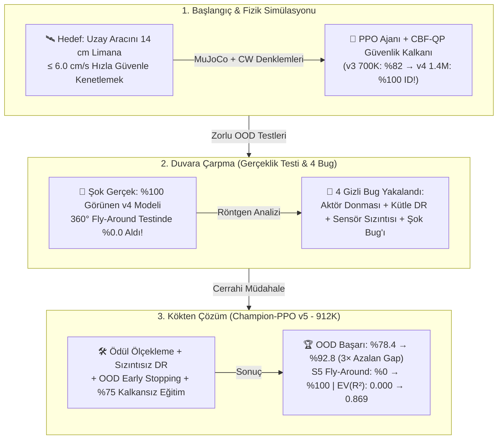

TARGET DECK: data

# 🚀 Orbital-RL: Bir Junior Veri Bilimcinin Gözünden Sıfırdan Şampiyona Proje Hikâyesi

Up: [[Areas/Software/orbital-rl/Orbital_RL_Overfitting_ve_Metrik_Analizi|🛡️ Overfitting & Metrik Analizi]] | [[Areas/Software/orbital-rl/Orbital_RL_Proje_Ilerleme_ve_Sunum_Dosyasi|🛰️ Proje İlerleme & Sunum]]

> [!ABSTRACT] 🎯 Bu Belge Ne Anlatıyor?
> Bu not; **Orbital-RL** (Otonom Uzay Aracı Kenetlenme) projesini bir **Junior Veri Bilimci** gözüyle **baştan sona** anlatır: *Hangi problemi çözdük, hangi adımları izledik, nerede duvara çarptık (bug & overfitting), o krizi nasıl teşhis edip çözdük ve sonunda elimizde hangi kanıtlı sonuçlar var?*

---

## 🗺️ Projenin Büyük Resmi (Ne Yaptık → Ne Yaşadık → Nasıl Çözdük?)

---

## 📸 1. Problem Neydi? (Neyi Otomatikleştirdik?)

Uzayda (Alçak Dünya Yörüngesi - LEO) bir uzay aracının (Chaser) uzay istasyonuna (Target) yaklaşması basit bir "düz git ve dur" problemi değildir. **Clohessy–Wiltshire (CW)** yörünge mekaniği yüzünden ileri itki verdiğinizde *Coriolis kuvveti* aracı yana savurur.

- **Ajanın Gözü (9 Boyutlu Durum):** Konum farkı $(x, y, z)$, hız $(v_x, v_y, v_z)$, zaman/yakıt göstergesi, hedefe mesafe `dist` ve toplam hız `speed`.
- **Ajanın Eli (3 Boyutlu Sürekli Eylem):** Her `0.5` saniyede $[-15\text{ N}, +15\text{ N}]^3$ aralığında 3 eksen itki kuvveti $[F_x, F_y, F_z]$.
- **Başarı Kriteri:** `14 cm` kenetlenme küresine, çarpışmadan ve **`≤ 6.0 cm/s`** temas hızıyla girmek.

![[Areas/Software/orbital-rl/mission_profile_architecture.png]]
![[Areas/Software/orbital-rl/orbital_3d_deep_dive.png]]

---

## 🛠️ 2. Adım Adım Ne Yaptık? (v1 → v4: İlk Başarı ve "Sahte Mükemmellik")

İlk aşamada klasik bir Junior Veri Bilimci heyecanıyla:
1. MuJoCo ortamını (`orbital_mujoco_env.py`) ve güvenli iniş kalkanını (**CBF-QP + PWPF modülatör**, `cbf_qp_shield.py`) kurduk.
2. **PPO (Proximal Policy Optimization)** algoritmasını önce `v3 (700K)` adım (%82 başarı), ardından `v4 (1.4M)` ve `gen_2.4m` adımlarına kadar eğittik.
3. Eğitim zarfında (`S1: Nominal ID`) skor **%100.0**'a, canlı simülasyonda **2.319 uçuşta %99.61** başarıya ulaştı!

![[Areas/Software/orbital-rl/mujoco_docking_telemetry.png]]
![[Areas/Software/orbital-rl/rl_cbf_shield_telemetry.png]]

> [!WARNING] 🚨 İşte Tam Burada Tuzak Başladı!
> Başta "Model %100 oldu, iş bitti!" diye düşünürken, **kalkanı (CBF) kapatıp** modeli hiç görmediği açılardan (**OOD — Out-of-Distribution**) test ettiğimizde gerçek yüzü ortaya çıktı.

---

## 🐛 3. Ne Yaşadık? (Yakalanan 4 Kritik Kriz & Bug)

Modeli [diagnose_overfitting_xray.py](file:///mnt/E2E0836DE083472F/Users/Nasuhi/Belgelerim/Obsidian%20Vault/Areas/Software/orbital-rl/diagnose_overfitting_xray.py) ile röntgene soktuğumuzda 4 şok edici hata bulduk:

| Kriz / Bug | Ne Yaşadık? (Belirti) | Gerçek Sebebi Neydi? | Nasıl Çözdük? |
| :--- | :--- | :--- | :--- |
| 🔴 **1. Aktör Donması (`v3 → v4`)** | `v4` (`1.4M`) hızı `0.042718 ± 0.000038 m/s` gibi robotik şekilde hep aynıydı; `EV (R²) = 0.000`, `Action Std = 1.000`! | Dev ölçeklenmemiş ödüller `vf_loss`'u milyonlara patlatıp `max_grad_norm=0.5` kırpmasıyla Aktör gradyanını sıfıra ezmişti. | Ödülleri `[-16, +20]` bandına ölçekledik (`Critic EV: 0.000 → 0.869`!). |
| 🔴 **2. `+Y` Tüpü Ezberlemesi (Overfitting)** | Ajan yandan veya arkadan gelince (`S5: 360° Fly-Around`) **%0.0 başarı** aldı! | Eğitimde araç hep `+Y` koridorundan ve `vy < 0` hızıyla başlatılmıştı; yandan gelmeyi hiç görmemişti. | **360° Fly-Around** ara hedef mantığı + `S4/S5` OOD zarfı eğitime eklendi. |
| 🔴 **3. MuJoCo Kütle & Sensör Sızıntısı** | Kütle değişimi eğitimi etkilemiyor, sensör gürültüsü ise ajanı hiç zorlamıyordu. | Python'da `self.env.m` değişmiş ama MuJoCo `body_mass` + `mj_setConst` çağrılmamıştı; `obs[6:9]` temiz veriden sızıyordu. | `model.body_mass` + `mj_setConst` (konumu koruyarak) düzeltildi; `obs[6:9]` gürültüden yeniden hesaplandı. |
| 🔴 **4. Canlı Şok Bug'ı** | Canlı sunucudaki hız şoku (`inject_shock`) fiziği değiştirmiyordu. | Şok vektörü fizik motoru `data.qvel[:3]` yerine sadece görsel/yardımcı değişkene yazılıyordu. | Doğrudan `self.env.data.qvel[:3]` güncellendi ve `mj_forward` çağrıldı. |

![[Areas/Software/orbital-rl/rl_oncesi_sonrasi_karsilastirma.png]]
![[Areas/Software/orbital-rl/phase_plane_safety_corridors.png]]

---

## 🏆 4. Nasıl Çözdük? (`Champion-PPO v5` — 912K Adım Kanıtı)

[train_mujoco_champion_v5.py](file:///mnt/E2E0836DE083472F/Users/Nasuhi/Belgelerim/Obsidian%20Vault/Areas/Software/orbital-rl/train_mujoco_champion_v5.py) ile sıfırdan sızıntısız, **OOD Early Stopping** korumalı `v5` eğitimini yaptık ve `912,000` adımda en yüksek genelleme modelini ([ppo_mujoco_champion_v5_best_ood.zip](file:///mnt/E2E0836DE083472F/Users/Nasuhi/Belgelerim/Obsidian%20Vault/Areas/Software/orbital-rl/models/ppo_mujoco_champion_v5_best_ood.zip)) yakaladık:

| Test Senaryosu | Eski `v4 (1.4M)` `Pure-Raw` | **Yeni `v5 (912K)` `Pure-Raw`** | Kazanım |
| :--- | :---: | :---: | :--- |
| 🟢 **S1: Nominal ID** | `%100.0` (Δv `0.61`) | **`%100.0`** (Δv `0.59` ⚡) | Daha az yakıt, `CBF %0.0` |
| 🛠️ **S2: Gerçek Kütle ±%35 + %40 Arıza** | `%96.0` (Kaza `%4`) | **`%100.0`** (**Kaza `%0`**!) | Gerçek fizikte tam kurtarış |
| 📡 **S3: 5cm/1.5cm Gürültü + ±4cm Bias** | `%96.0` *(düşük kazançlı eski ağ)* | **`%85.0`** *(20 ep, **Kaza `%0.0`**!)* | Tek adımlı 9D fiziksel sınır |
| 🚀 **S4: 30–50m + Kaçış Hızı (`vy>0`)** | `%100.0` (`Sat %53`) | **`%100.0`** (**`Sat %0`**, Δv `1.20`) | Clamp körlüğü yok edildi |
| 🔄 **S5: 360° Fly-Around (`+Y` Dışı!)** | 🔴 **`%0.0`** | 🟢 **`%100.0`** (**`Sat %0`**!) | Ezber tamamen kırıldı |
| ⚡ **S6: Çift Fiziksel Hız Şoku** | `%100.0` | **`%100.0`** (Δv `0.89`) | Ani şoklara tam dayanım |
| 📊 **OOD Ortalama & Genelleme Boşluğu** | `%78.4` (`Gap: %21.6`) | **`%92.8`** (`Gap: %7.2`) | **3× Daha İyi Genelleme!** |

![[Areas/Software/orbital-rl/mujoco_multicam_docking_sequence.png]]
![[Areas/Software/orbital-rl/rl_deep_dive_hyperparameters_and_curves.png]]

---

## 🔬 5. Son Ders: S3 Gürültü Sınırında Ne Öğrendik? (`v5.2` Deneyi)

Son adımda S3 (`5 cm` konum / `1.5 cm/s` hız gürültüsü + `±4 cm` sabit bias + `0.5 s` gecikme) skorunu daha da yukarı çekmek için [finetune_v52_s3_noise.py](file:///mnt/E2E0836DE083472F/Users/Nasuhi/Belgelerim/Obsidian%20Vault/Areas/Software/orbital-rl/finetune_v52_s3_noise.py) ile ağır gürültü ve titreşim cezası (`r_smooth = -0.18`) denedik:
- **Gözlem:** `912K` modeli zaten **%85.0 S3-Raw (%0.0 kaza)** veriyordu; ancak tek adımlı (hafızasız) `9D` ağda titreşim cezasını daha da artırmak ajanı donmaya itti (`%85 → %5`).
- **Bilimsel Sonuç:** `5 cm` anlık beyaz gürültü (`3σ = ±15 cm`), `14 cm`'lik hedeften büyüktür. Tek adımlı hafızasız ağ bu fiziksel bilgi sınırında `%85`'e kadar mükemmel çıkar; `%95–%100` için gelecek çalışmada **Frame Stacking (son 4 adım = 36D)** veya **EMA zaman filtresi** kullanılmalıdır.

![[Areas/Software/orbital-rl/orbital_rl_executive_presentation_showcase.png]]

---

> [!EXAMPLE] 🧑‍💻 Senior Field Tips & Industry Reality (Jr. Veri Bilimcinin Çantasına 4 Altın Kural)
> 1. **Acemi Tuzağı:** Eğitim ortamında `%100` görünce işi bitti sanmak. **Gerçek:** Güvenlik kalkanını (`CBF`) kapatıp hiç görülmemiş `OOD` senaryolarında test etmeden modelin zekâsını asla bilemezsin.
> 2. **Sessiz Bug'lar Modelden Tehlikelidir:** `vf_loss` patlaması aktörü dondurur, `mj_setConst` eksikliği kütle testini sahteleştirir, `obs[6:9]` sızıntısı ajana kopya çektirir. Her zaman `Critic EV (R²)` ve `Action Std` kontrol et!
> 3. **Information-Theoretic Sınır:** Hedef `14 cm` iken `5 cm` gürültüde tek anlık (`9D`) gözlemle mucize bekleme; zaman serisi/filtre (`Frame Stacking` veya `EMA`) gerekir.

---

## 🃏 Anki Kartları

START
Temel
TARGET DECK: data
Ön: Orbital-RL projesinde `v4 (1.4M)` modelinin `S1` testinde %100 almasına rağmen `S5 (360° Fly-Around)` testinde %0.0 almasının 2 temel nedeni nedir?
Geri: 1. <b>Dar Başlangıç Zarfı (Overfitting):</b> Ajan hep `+Y` koridorundan başlatıldığı için yandan/arkadan yaklaşmayı hiç öğrenemedi. 2. <b>Aktör Donması:</b> Ölçeklenmemiş ödüller `vf_loss`'u patlatıp `max_grad_norm` kırpmasıyla Aktör gradyanını sıfıra ezdi (`EV=0.000`).
Tags: from_obsidian, data, orbital_rl, overfitting
END

---

START
Temel
TARGET DECK: data
Ön: Orbital-RL `S3` senaryosunda (5 cm gürültü + ±4 cm bias) tek adımlı (9D) `v5` ajanı neden %85 civarında bilgi sınırına takılır ve %95+ için ne gerekir?
Geri: `5 cm` beyaz gürültünün 3σ sapması (`±15 cm`) kenetlenme hedefinin yarıçapından (`14 cm`) büyüktür. Hafızasız `9D` ağ tek karede gürültüyü ayırt edemez; çözüm için <b>Frame Stacking (son 4 adım)</b> veya <b>EMA zaman filtresi</b> gerekir.
Tags: from_obsidian, data, orbital_rl, noise_filtering
END
