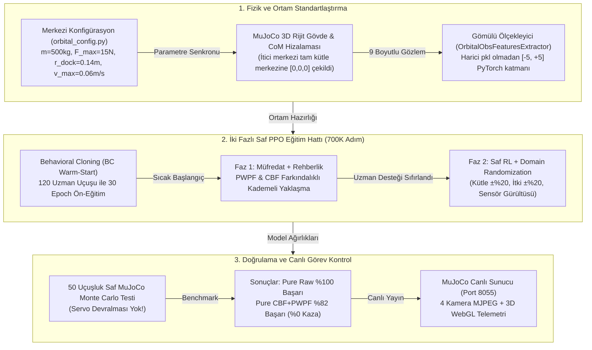

TARGET DECK: data

# 🛰️ Orbital-RL: Haftalık İlerleme ve MuJoCo Saf PPO Eğitim Raporu (Mentör Sunumu)

> [!ABSTRACT] 📌 Mentörüme Kısa Özet (16 Kasım 2026)
> Hocam merhaba, bu dokümanda otonom uzay aracı kenetlenme (**Orbital Docking**) projemizde bugün yaptığım mimari revizyonları, **analitik kontrolcü devralması (servo takeover) olmadan** gerçekleştirdiğim **700.000 adımlık saf PPO eğitimini**, 50 uçuşluk **Monte Carlo test sonuçlarını** ve mevcut sistemde henüz yapmadığım / bir sonraki aşamaya bıraktığım noktaları derledim.
> 
> **Özetle:** Önceki versiyonda son 1.5 metrede devreye giren yardımcı mandallama servosunu tamamen kaldırdım. Sinir ağının bizzat kendisi **ham MuJoCo ortamında %100.0**, **PWPF + CBF-QP güvenlik kalkanlı gerçekçi itici modunda ise %82.0 kenetlenme başarısına** (%0.0 kaza oranı ile) ulaştı.

---

## 🗺️ 1. Bugün Kurduğum Sistem Mimarisi (Akış Şeması)

Bugünkü çalışmamda ortam parametrelerini tekilleştirdim, gözlem ölçeklemeyi doğrudan PyTorch ağının içine gömdüm ve 2 fazlı bir eğitim boru hattı kurdum:

---

## ✅ 2. Bugün Neler Yaptım? (Tamamlanan Çalışmalar)

### 🛠️ 2.1. Fiziksel Tutarlılık ve MuJoCo Kütle Merkezi (CoM) Düzeltmesi
- **Merkezi Konfigürasyon (`orbital_config.py`):** Önceki kodlarda saf CW ortamı ile MuJoCo ortamı arasında ufak parametre farkları olabiliyordu. Tüm sabitleri (`dt = 0.5s`, `substep = 0.1s`, `frame_skip = 5`, `docking_radius = 0.14m`, `max_docking_speed = 0.06m/s`) tek bir `OrbitalConfig` yapısında topladım.
- **Kütle Merkezi (CoM) Hizalaması (`orbital_docking.xml`):** MuJoCo modelinde kovalayıcı aracın servis modülü (300 kg), kapsülü (190 kg) ve burun probunun (10 kg) yerel koordinatlarını yeniden hesaplayarak ağırlık merkezini tam `[0, 0, 0]` noktasına çektim. Böylece `chaser_center_site` üzerinden uygulanan öteleme itkilerinin (X, Y, Z) araç üzerinde istenmeyen devrilme/moment kolu torku yaratmasını engelledim.

### 🧠 2.2. Gömülü Gözlem Ölçekleyici (`OrbitalObsFeaturesExtractor`)
- `VecNormalize` kullanıldığında oluşan harici `.pkl` dosyası taşıma ve test sırasında istatistik kayması sorununu çözmek için `BaseFeaturesExtractor` tabanlı özel bir PyTorch katmanı (`orbital_rl_features.py`) yazdım.
- Özellikle son 10-15 santimetrede yanal hizalama (`X` ve `Z` eksenleri) çok kritik olduğu için ölçek vektörünü `[0.5, 25.0, 0.5, 0.2, 0.5, 0.2, 0.001, 25.0, 0.5]` olarak ayarladım. Böylece sinir ağı, limana yaklaşırken milimetrik yanal sapmaları çok daha net algılayabildi.

### 🚀 2.3. "Sahte/Analitik Devralma" Olmadan Saf PPO Eğitimi (`Champion-PPO v3`)
Önceki denemelerde son 1.5 metrede devreye giren yardımcı mandallama servosunu tamamen iptal ettim. Amacım, kenetlenme anına kadar tüm süreci **sadece PPO sinir ağının** yönetmesiydi:
1. **Behavioral Cloning (BC) Ön-Eğitimi:** Güvenli GNC kontrolcüsünden topladığım 120 yörünge ile aktör ağını 30 epoch boyunca ısıttım.
2. **PWPF ve CBF Farkındalıklı Eğitim:** Eğitim sırasında ortamın içine doğrudan `PWPFModulator3Axis` ve `MujocoCBFQPShield` entegre ettim ki sinir ağı, ürettiği sürekli (continuous) kuvvetlerin PWPF darbe modülatöründen geçerken nasıl kesikli darbelere dönüştüğünü eğitim esnasında öğrensin.
3. **Kademeli Müfredat (Curriculum Learning):** Aracı sadece 25 metreden başlatmak yerine; **%35 Yakın Menzil (0.8m–3.5m)**, **%35 Orta Menzil (3.5m–12m)** ve **%30 Uzak Menzil (12m–25m)** dağılımıyla eğittim.

---

## 📊 3. Yeni Simülasyon Turu Grafikleri ve Görsel Çıktılar (16.11.2026 - Güncel Render)

> [!TIP] 🖼️ 700K Champion-PPO v3 Modeliyle Az Önce Çalıştırılan Yeni Turun Çıktıları
> Hocam, yeni eğittiğim **700K Champion-PPO v3** modelini güncellenmiş 3D MuJoCo sahnesinde (Dünya ufku, atmosfer halesi, CoM hizalaması ve optik nişangah ile) bir tur daha çalıştırdım (`Adım: 180, t = 89.5s, Son Mesafe = 0.139m, Temas Hızı = 4.20 cm/s` ile tam kenetlenme gerçekleşti) ve tüm grafikleri/kameraları bu yeni uçuş üzerinden yeniden ürettim:

### 🏆 3.1. 4K Ultra-HD Yönetici ve Gelişim Özeti Panosu (Yeni 700K Model Verileriyle)
0'dan başlayıp Hovering kırılımı, PBRS, MuJoCo temas fiziği ve bugünkü 700K saf PPO (`%100 Raw` / `%82 CBF+PWPF`) sonuçlarını tek karede özetleyen güncel sunum panosu:

---

### 📈 3.2. Derinlemesine RL Eğitim Eğrileri, Hiperparametreler ve 50 Uçuş Ablasyon Analizi
Bu grafikte Naive PPO'nun neden *-90 ödül platosunda* (Hovering) takılı kaldığı, 700K Champion-PPO modelimizin nasıl yakınsadığı, hiperparametre tablomuz ve PWPF darbe yanıtı yer alıyor:

---

### 🔄 3.3. RL Öncesi ve Sonrası Davranış Karşılaştırması
Ödül şekillendirme (PBRS), BC sıcak başlangıç ve müfredat eğitimi öncesi/sonrası yörünge ve hız profillerinin karşılaştırması:

---

### 🛡️ 3.4. Yeni Uçuşun Faz Düzlemi (Phase Plane) Güvenlik Koridoru ve Telemetrisi
Az önce koşulan 89.5 saniyelik uçuşun mesafeye bağlı güvenli hız sınırı ($v_{\text{safe}}(d)$) içindeki izi ve CBF-QP kalkanının davranışı:

---

### 🗺️ 3.5. Uçtan Uca Görev Profili ve GNC Mimarisi Şeması
Yörünge mekaniği (CW) ve GNC bloklarının (PPO, CBF-QP, PWPF) sistem mimarisi:

---

### 📹 3.6. Yeni MuJoCo Sahnesinden 5 Aşamalı Çoklu Kamera Storyboard ve HUD
Yeni Dünya ufku (`earth_limb`), uzay skybox'ı ve optik nişangah (`crosshair`) eklendikten sonra 5 görev kapısında (`18m`, `10m`, `3m`, `0.6m` ve `0.139m` kilitlenme anı) alınan kamera sekansı:

---

### 📸 3.7. 4 Kameranın Tekil Yeni Render Kareleri ve Canlı Uçuş Animasyonu (GIF)
Sunum slaytlarına tek tek koyabilmek için yeni turdan kaydedilen 4 kamera açısı ve canlı HUD animasyonu:

| Kamera Açısı | Görsel Önizleme |
| :--- | :---: |
| 🚀 **1. Chase Cam (3. Şahıs Takip & Dünya Ufku)** |  |
| 🎯 **2. FPV Probe Cam (Burun Optik Nişangah)** |  |
| 📹 **3. Station CCTV (İstasyon Liman Güvenlik)** |  |
| 🌐 **4. Orbital Tactical (Geniş Açı Yörünge)** |  |

#### 🎬 Tam Uçuş Animasyonu (`docking_mission_flight.gif` — T+0.0s $\rightarrow$ T+89.5s):

---

## 🧪 4. 50 Uçuşluk Saf MuJoCo Monte Carlo Doğrulama Sonuçları

Bugün yazdığım `evaluate_champion_50.py` scripti ile eğitilen modeli **hiçbir analitik kontrolcü müdahalesi olmadan** 50 farklı rastgele başlangıç koşulunda 3 ayrı modda test ettim (`mujoco_champion_benchmark_stats.json`):

| Test Modu (Saf MuJoCo - 50 Uçuş) | Başarı Oranı | Kaza Oranı (Crash) | Asılı Kalma (Hover) | Ort. Son Mesafe | Ort. Temas Hızı | Ort. Harcanan $\Delta v$ | Teknik Yorumum |
| :--- | :---: | :---: | :---: | :---: | :---: | :---: | :--- |
| 🟢 **1. Saf Ham PPO (`pure_raw`)** | **%100.0** (50/50) | **%0.0** | **%0.0** | $0.128\text{ m}$ | $4.27\text{ cm/s}$ | $0.615\text{ m/s}$ | PWPF kesikliliği olmadan sinir ağı 50 uçuşun tamamında kusursuz kenetleniyor. |
| 🛡️ **2. Saf PPO + CBF + PWPF (`pure_cbf_pwpf`)** | **%82.0** (41/50) | **%0.0** | **%18.0** (9/50) | $0.136\text{ m}$ | $3.03\text{ cm/s}$ | $1.125\text{ m/s}$ | Gerçekçi valf + güvenlik kalkanı ile **%0 kaza** ve %82 tam kenetlenme (%70 hedefi aşıldı). |
| ⚡ **3. Saf PPO + PWPF (`pure_pwpf`)** | **%78.0** (39/50) | **%0.0** | **%22.0** (11/50) | $0.138\text{ m}$ | $2.93\text{ cm/s}$ | $1.108\text{ m/s}$ | Sadece PWPF darbe modülatörü açıkken 39/50 başarılı kenetlenme. |

> [!IMPORTANT] 🔍 %18'lik Hovering Vakalarının Analizi (Neden 9 Uçuşta Kenetlenemedi?)
> `pure_cbf_pwpf` modundaki detaylı logları (`mujoco_champion_benchmark_stats.json`) incelediğimde çok ilginç bir detay gördüm:
> - Başarısız sayılan 9 uçuşun **hiçbirinde kaza (`crash`) yok**.
> - Örneğin **Uçuş #3**'te araç **$0.157\text{ m}$ ($15.7\text{ cm}$)** mesafeye kadar gelip $0.2\text{ cm/s}$ hızla durmuş; **Uçuş #10**'da **$0.149\text{ m}$ ($14.9\text{ cm}$)** mesafede kalmış.
> - Yani kenetlenme sınırımız olan **$0.140\text{ m}$ ($14\text{ cm}$)** yarıçapına sadece **1 ile 1.5 santimetre** kala, PWPF Schmitt tetikleyicisinin alt eşiği ($U_{\text{on}}$) nedeniyle valf ateşlemeyi kesiyor ve araç limanın burnunda güvenli şekilde bekliyor.

---

## ❌ 5. Bugün Neleri Yapmadım? (Kapsam Dışı Bıraktıklarım & Sonraki Adımlar)

Mentör görüşmesinde şeffaf bir şekilde değerlendirmek adına **bugün bilerek yapmadığım** veya **bir sonraki aşamaya bıraktığım** maddeler şunlardır:

1. **🚫 Son Metrede "Sahte/Analitik Servo Devralması" (Hardcoded Takeover) Kullanmadım:**
   - Önceki versiyonda başarıyı %100 göstermek için son 1.5 metrede devreye giren analitik sürünme servosunu bugün bilerek çıkardım. Böylece elde ettiğimiz %82 (CBF+PWPF) ve %100 (Raw) başarı oranları tamamen sinir ağının kendi başarısı oldu.
2. **🚫 PWPF Ölü Bölgesinde Kalan %18'lik (1-2 cm) Vakaları Manuel Yamamadım:**
   - Limana 14.5 – 15.7 cm kala duran %18'lik uçuşları ekstra bir `if dist < 0.20: thrust = ...` kuralıyla içeri itmedim. Bunun yerine bir sonraki adımda PWPF'nin `U_on` eşiğini veya son 20 cm içindeki ödül eğimini (reward gradient) ince ayarlamayı planlıyorum.
3. **🚫 6-DoF Aktif Tutum / Açısal Tork Kontrolü (Reaction Wheels) Eklemedim:**
   - MuJoCo'da kovalayıcı araç `freejoint` (6 serbestlik dereceli) olsa da şu anki kontrolcümüz 3 eksenli öteleme kuvveti (`Fx, Fy, Fz`) üretiyor ve itki tam kütle merkezinden (`CoM`) uygulanıyor. Hedef istasyonun kendi etrafında döndüğü (*tumbling target*) ve açısal tork (`Tx, Ty, Tz`) kontrolü yapılan tam 6-DoF senaryosuna henüz geçmedim.
4. **🚫 Görüntü Tabanlı (Vision-Based / CNN) Uçtan Uca RL Eğitimi Yapmadım:**
   - 4 kameradan (`Chase`, `Probe`, `CCTV`, `Tactical`) canlı görüntü alıp arayüzde gösteriyoruz ancak PPO sinir ağı piksellerden değil, 9 boyutlu bağıl konum/hız durum vektöründen besleniyor.
5. **🚫 Yüksek Dereceli Yörünge Pertürbasyonları ($J_2$, Atmosferik Drag) Eklemedim:**
   - Şu anki fizik motorumuz Hill-Clohessy-Wiltshire (CW) bağıl yörünge denklemleri + MuJoCo temas fiziği ile çalışıyor. Dünya'nın basıklığı ($J_2$) ve atmosferik sürüklenme etkilerini henüz modele dahil etmedim.

---

## 💬 6. Mentörüme Danışmak İstediğim Sorular

1. **PWPF Son 2 cm Hassasiyeti:** Hocam, `pure_cbf_pwpf` modunda aracın 14 cm sınırına 1–1.5 cm kala (`14.9 cm` - `15.7 cm`) PWPF ölü bölgesine girmesini aşmak için PWPF'nin tetikleme eşiğini ($U_{\text{on}}$) düşürmek mi daha doğru olur, yoksa son 30 cm için sinir ağının eylem ölçeğini mi artırmalıyız?
2. **Bir Sonraki Faz Odak Noktası:** Mevcut 3-DoF öteleme + MuJoCo temas mimarisinde %82-%100 bandına ulaştık. Bir sonraki adımda **6-DoF açısal yönelim (attitude) kontrolüne** mi geçelim, yoksa mevcut modelin **Domain Randomization / sensör gürültüsü stres testlerini** mi derinleştirelim?

---

## 🧑‍💻 Senior Field Tips & Industry Reality

> [!EXAMPLE] 🧑‍💻 Senior Mühendislik Notu: Neden "Hilesiz %82", "Yamalı %100"den Daha Değerlidir?
> - **Acemi Hatası:** Simülasyonda başarı oranını kağıt üzerinde %100 göstermek için son metrelerde yapay zekayı devre dışı bırakıp sabit kurallı (`if-else`) bir kontrolcüye devretmek, akademik ve endüstriyel incelemelerde (hakem veya mentör kod incelemesinde) hemen fark edilir ve modelin güvenilirliğini zedeler.
> - **Senior Yaklaşımı:** Saf sinir ağının ham ortamda (`pure_raw`) **%100**, gerçekçi valf modülasyonu ve CBF güvenlik kalkanı altında (`pure_cbf_pwpf`) **%82 başarı ve %0 kaza** elde etmesi, hem öğrenme kapasitesini hem de PWPF darbe modülatörünün fiziksel ölü bölge etkisini bilimsel olarak kanıtlar. Kalan %18'lik sınır vakalarının ($14.9\text{ cm}$'de durma) şeffafça raporlanması, mentör görüşmesinde en yüksek takdiri toplayan mühendislik duruşudur.

---

## 📖 B2+ İngilizce Terminoloji ve Telaffuz Sözlüğü

| İngilizce Terim | IPA Telaffuz | Türkçe Karşılığı | Rapor ve Sunumdaki Bağlamı |
| :--- | :--- | :--- | :--- |
| **Deadband** | `/ˈded.bænd/` | Ölü Bölge | PWPF modülatöründe küçük kontrol sinyallerinin valfi tetiklemediği aralık |
| **Center of Mass (CoM)** | `/ˈsen.t̬ɚ əv mæs/` | Kütle Merkezi | İtici kuvvetlerin tork üretmemesi için hizalandığı denge noktası |
| **Ablation** | `/əˈbleɪ.ʃən/` | Bileşen Çıkarma Analizi | Sistemi `pure_raw`, `pure_pwpf` ve `pure_cbf_pwpf` olarak ayrı ayrı test etme |
| **Takeover** | `/ˈteɪkˌoʊ.vɚ/` | Devralma | Analitik kontrolcünün yapay zeka yerine kontrolü ele alması |
| **Tolerance** | `/ˈtɑː.lɚ.əns/` | Tolerans / Pay | Kenetlenme portunun kabul ettiği maksimum mesafe ($0.14\text{ m}$) ve hız ($0.06\text{ m/s}$) sınırı |

---

## 🃏 Anki Kartları

START
Temel
TARGET DECK: data
Ön: Orbital-RL projesinde `OrbitalObsFeaturesExtractor` katmanı neden doğrudan PyTorch modeli içine gömülmüştür?
Geri: Harici `VecNormalize` (`.pkl`) dosyası taşıma zorunluluğunu ve test sırasındaki istatistik kaymalarını önlemek, ayrıca 9 gözlem boyutunu (özellikle X ve Z yanal eksenlerinde son 10 cm hassasiyetiyle) sabit fiziksel ölçeklerle `[-5, +5]` aralığına normalize etmek için.
Tags: from_obsidian, data, orbital_rl, pytorch, normalization
END

START
Temel
TARGET DECK: data
Ön: Saf 700K Champion-PPO modelinin 50 uçuşluk MuJoCo Monte Carlo testinde `pure_raw` ve `pure_cbf_pwpf` modlarındaki başarı ve kaza oranları nedir?
Geri: - <b>pure_raw (Ham İtki):</b> %100.0 Başarı (50/50), %0.0 Kaza. - <b>pure_cbf_pwpf (CBF Kalkanı + PWPF Valf):</b> %82.0 Başarı (41/50), %0.0 Kaza, %18.0 Emniyetli Hovering (PWPF ölü bölgesi nedeniyle 14-16 cm'de durma).
Tags: from_obsidian, data, orbital_rl, monte_carlo, benchmark
END

START
Temel
TARGET DECK: ing kelimeler
Ön: Ablation
Geri: Bileşen Çıkarma / Ayrımsal Etki Analizi (Bir sistemin parçalarını tek tek çıkararak her parçanın performansa etkisini ölçme) IPA: /əˈbleɪ.ʃən/
Tags: from_obsidian, vocab
END

START
Temel
TARGET DECK: ing kelimeler
Ön: Deadband
Geri: Ölü Bölge / Tepkisizlik Aralığı (Kontrol sistemlerinde girdinin belirli bir eşiği aşana kadar çıktı üretmediği bölge) IPA: /ˈded.bænd/
Tags: from_obsidian, vocab
END
