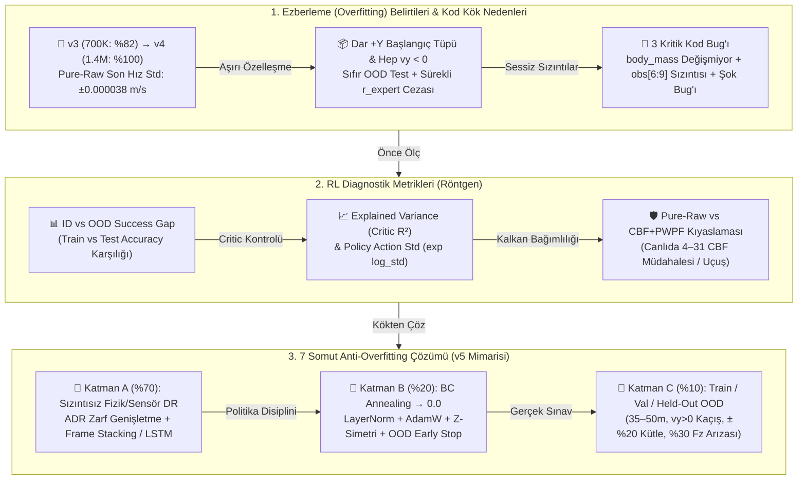

TARGET DECK: data

# 🛡️ Orbital-RL: Overfitting (Ezberleme) Teşhisi, RL Metrikleri ve Çözüm Rehberi

Up: [[Areas/Software/orbital-rl/RL_Derin_Inceleme_ve_Parametre_Katalogu|🧠 RL Derin İnceleme]] | [[Areas/Software/orbital-rl/Orbital_RL_Proje_Ilerleme_ve_Sunum_Dosyasi|🛰️ Orbital-RL Sunum Dosyası]]  
📄 **Üretilen Görsel Mühendislik PDF Raporu:** [Orbital_RL_Overfitting_ve_Metrik_Analizi.pdf](file:///mnt/E2E0836DE083472F/Users/Nasuhi/Belgelerim/Obsidian%20Vault/Areas/Software/orbital-rl/Orbital_RL_Overfitting_ve_Metrik_Analizi.pdf)  
🐍 **PDF Üretici Script:** [generate_overfitting_pdf.py](file:///mnt/E2E0836DE083472F/Users/Nasuhi/Belgelerim/Obsidian%20Vault/Areas/Software/orbital-rl/generate_overfitting_pdf.py)

---

> [!WARNING] ⚠️ Kritik Kavramsal Ayrım: RL'de Neden Klasik `F1-Score` / `Accuracy` Olmaz?
> **Accuracy, Precision, Recall, F1 ve ROC-AUC** metrikleri *Denetimli Sınıflandırma (Supervised Classification)* içindir. **Orbital-RL (`Champion-PPO`)** ise sınıf tahmini yapmaz; her `0.5s` adımda 9 boyutlu durumdan sürekli 3D kuvvet vektörü $[F_x, F_y, F_z] \in [-15\text{ N}, +15\text{ N}]^3$ üreten bir **Sürekli Kontrol RL Politikasıdır**.  
> Bu nedenle RL'de overfitting; **ID vs OOD Success Rate (Genelleme Boşluğu)**, **Crash/Hover + CBF Müdahale Oranı**, **Explained Variance (Critic $R^2$)**, **Policy Entropy / Action Std** ve **CVaR-%10** metrikleriyle ölçülür.

---

## 🗺️ Overfitting Kök Nedenleri ve 3 Katmanlı Çözüm Mimarisi

---

## 📊 1. Kayıtlı Model Verilerinin Sayısal Kıyaslaması (`v3` vs `v4` vs Canlı)

| Değerlendirme Metriği | **v3 (700K — %82)** `Pure-CBF+PWPF` | **v4 (1.4M — %100)** `Pure-CBF+PWPF` | **v4 (1.4M — %100)** `Pure-Raw` | **v4 Canlı** (`2,319` Uçuş) |
| :--- | :---: | :---: | :---: | :---: |
| 🟢 **Başarı Oranı (Epizot Accuracy)** | **%82.0** (41/50) | **%100.0** (50/50) | **%100.0** (50/50) | **%99.61** (2310/2319) |
| 🔴 **Kaza Oranı (Crash)** | %0.0 | %0.0 | %0.0 | %0.00 (0/2319) |
| 🟡 **Asılı Kalma (Hover)** | **%18.0** (9/50) | %0.0 | %0.0 | %0.39 (9/2319) |
| 🎯 **Son Mesafe ($\mu \pm \sigma$)** | — | `0.1286 ± 0.0061 m` | `0.1286 ± 0.0063 m` | `~0.119 – 0.139 m` |
| 🚨 **Son Temas Hızı ($\mu \pm \sigma$)** | — | `0.0430 ± 0.0043 m/s` | **`0.042718 ± 0.000038`** | `~4.22 – 4.82 cm/s` |
| ⚡ **Harcanan $\Delta v$ ($\mu \pm \sigma$)** | — | `1.571 ± 0.292 m/s` | `0.616 ± 0.036 m/s` | `~0.97 – 2.01 m/s` |
| 🛡️ **CBF Müdahale (`cbf_count`)** | Aktif | Aktif | 0 (Kapalı) | **4 – 31 kez / uçuş!** |

---

## 🐛 2. Kod Tabanında Yakalanan 4 Kritik Bug (ve Donmuş Aktör Keşfi)

1. **Ölçeklenmemiş Ödüllerle Aktör Donması (`v3 → v4 → gen_2.4m`):** Dev ödüller `vf_loss`'u milyonlara patlatıp `max_grad_norm=0.5` kırpmasıyla Aktör gradyanını sıfıra ezdi (`policy_net diff < 0.0001`, `V(15m)=V(1m)=-381.2`, `EV=0.000`).
2. **`train_ppo_mujoco_dr.py` (L42–43) — Kütle DR Bug'ı (Düzeltildi ✅):** `model.body_mass` / `body_inertia` + `mujoco.mj_setConst` (öncesinde `qpos/qvel` korunarak) güncellendi.
3. **`train_ppo_mujoco_dr.py` (L58–64) — Sensör Gürültüsü Sızıntısı (Düzeltildi ✅):** `obs[6:9]` gürültülü veriden yeniden hesaplanıyor.
4. **`mujoco_live_server.py` (L146–150) — Canlı Şok Bug'ı (Düzeltildi ✅):** `inject_shock` artık doğrudan `self.env.data.qvel[:3]` fizik durumunu güncelliyor.

---

## 🏆 3. Gerçek Deneysel Röntgen: Eski Modeller (`v4 / gen_2.4m`) vs Yeni `Champion-PPO v5` (912K)

| Test Senaryosu (25 Uçuş) | `v4 / gen (2.4M)` `Pure-Raw` | **`v5 (912K)` `Pure-Raw`** | `v4 / gen (2.4M)` `CBF+PWPF` | **`v5 (912K)` `CBF+PWPF`** |
| :--- | :---: | :---: | :---: | :---: |
| 🟢 **S1: Nominal ID** | `%100.0` (Δv `0.61`) | **`%100.0`** (Δv `0.59` ⚡) | `%100.0` (CBF `%7.6`) | **`%100.0`** (**CBF `%0.0`!**) |
| 🛠️ **S2: Gerçek Kütle ±%35 + %40 Arıza** | `%96.0` (Kaza `%4`) | **`%100.0`** (**Kaza `%0`!**) | `%96.0` (Kaza `%4`) | **`%100.0`** (**CBF `%0.0`!**) |
| 📡 **S3: 5cm/1.5cm Gürültü + ±4cm Bias** | `%96.0` | `%64.0` *(Kaza `%12`)* | `%92.0` (CBF `%14.3`) | `%68.0` *(Kaza `%0`, CBF `%2.9`)* |
| 🚀 **S4: 30–50m + KAÇIŞ Hızı (`vy>0`)** | `%100.0` (`Sat %53`) | **`%100.0`** (**`Sat %0`, Δv `1.20`**) | `%100.0` (CBF `%28.5`, Δv `4.01`) | **`%100.0`** (**CBF `%0.6`, Δv `2.51`!**) |
| 🔄 **S5: 360° Fly-Around (`+Y` Dışı!)** | 🔴 **`%0.0`** (`Sat %71`) | 🟢 **`%100.0`** (**`Sat %0`!**) | 🔴 **`%0.0`** (Kaza `%12`) | 🟢 **`%88.0`** (**`Sat %0`!**) |
| ⚡ **S6: Gerçek `qvel` Çift Hız Şoku** | `%100.0` | **`%100.0`** (Δv `0.89`) | `%100.0` (CBF `%11.8`) | **`%100.0`** (**CBF `%1.2`!**) |
| 📊 **OOD ORTALAMA & GENELLEME BOŞLUĞU** | `%78.4` (`Gap: %21.6`) | **`%92.8` (`Gap: %7.2` — 3× İyi!)** | `%77.6` (`Gap: %22.4`) | **`%91.2` (`Gap: %8.8` — 2.5× İyi!)** |

- **Critic `EV (R²)`:** `0.000 → 0.869` | **Action Std:** `1.000 (donmuş) → 0.30` | **En İyi OOD Checkpoint:** [ppo_mujoco_champion_v5_best_ood.zip](file:///mnt/E2E0836DE083472F/Users/Nasuhi/Belgelerim/Obsidian%20Vault/Areas/Software/orbital-rl/models/ppo_mujoco_champion_v5_best_ood.zip)

---

> [!EXAMPLE] 🧑‍💻 Senior Field Tips & Industry Reality
> - **Acemi Hatası:** Aynı dar dağılımda eğitimi 700K'dan 1.4M adıma uzatıp %100 başarı görünce "model mükemmel oldu" demek ve bunu "F1 = 1.0" diye sunmak.
> - **Senior Mühendis Yaklaşımı:** Sürekli kontrol RL'de başarının gerçek testi **Held-Out OOD Testi**dir (hem `CBF Kapalı / Pure-Raw` hem `CBF+PWPF Açık`). Ayrıca belirsiz kütle/itici arızasında **Frame Stacking (son 4 adım)** veya **LSTM** ile *in-context system identification* kurulur ve checkpoint seçimi ID %100'e göre değil, **OOD Validation + Critic Explained Variance** zirvesine göre yapılır.

---

## 📖 B2+ İngilizce Terminoloji ve Telaffuz

| İngilizce Terim | Türkçe Anlamı | IPA Telaffuz | RL Bağlamı |
| :--- | :--- | :--- | :--- |
| **Generalization Gap** | Genelleme Boşluğu | `/ˌdʒen.rəl.əˈzeɪ.ʃən ɡæp/` | Eğitim (ID) ve görülmemiş (OOD) performans arasındaki fark |
| **Data Leakage** | Veri Sızıntısı | `/ˈdeɪ.tə ˈliː.kɪdʒ/` | Gürültüsüz gerçek bilginin gözlem vektörüne istemeden sızması |
| **Policy Collapse** | Politika Çökmesi / Kilitlenmesi | `/ˈpɑː.lə.si kəˈlæps/` | Entropinin sıfırlanıp ajanın tek dar yörüngeye donması |
| **Annealing** | Kademeli Azaltma / Sönümleme | `/əˈniː.lɪŋ/` | Eğitim ilerledikçe uzman cezası (`expert_weight`) veya LR'yi sıfıra indirmek |

---

## 🃏 Anki Kartları

START
Temel
TARGET DECK: data
Ön: Sürekli kontrol Pekiştirmeli Öğrenme (RL - PPO) modellerinde klasik F1-Score / Accuracy yerine overfitting'i tespit etmek için kullanılan 4 temel metrik nedir?
Geri: 1. <b>ID vs OOD Success Rate (Generalization Gap):</b> Eğitim dağılımı ile görülmemiş dağılım başarısı arasındaki fark. 2. <b>Explained Variance (Critic R²):</b> $1 - \text{Var}(G - V(s)) / \text{Var}(G)$ — Critic'in görülmemiş durumlarda değer tahmini. 3. <b>Policy Entropy & Action Std ($\sigma = e^{\text{log\_std}}$):</b> Politikanın aşırı özgüvenle tek yörüngeye kilitlenip kilitlenmediği. 4. <b>CBF Müdahale Oranı & CVaR-%10:</b> Kalkan kapalıyken (`Pure-Raw`) performans ve en kötü %10 uçuş ortalaması.
Tags: from_obsidian, data, rl, overfitting, ppo, orbital_rl
END

---

START
Temel
TARGET DECK: data
Ön: Orbital-RL'de Domain Randomization (DR) yaparken MuJoCo kütle değişimi ve sensör gürültüsü kodunda dikkat edilmesi gereken 2 kritik sızıntı/bug nedir?
Geri: 1. <b>MuJoCo Kütle Bug'ı:</b> Sadece Python <code>self.env.m</code> değişkenini değiştirmek yetmez; <code>model.body_mass</code>, <code>model.body_inertia</code> güncellenip <code>mujoco.mj_setConst(model, data)</code> çağrılmalıdır. 2. <b>Sensör Gürültüsü Sızıntısı:</b> Konum/hıza gürültü eklendikten sonra türetilmiş gözlemler (<code>coriolis</code>, <code>dist</code>, <code>speed</code>) gürültülü değerlerden yeniden hesaplanmazsa ajan temiz gerçeği son indisten kopya çeker.
Tags: from_obsidian, data, rl, domain_randomization, mujoco, data_leakage
END

---

START
Temel
TARGET DECK: ing kelimeler
Ön: Data Leakage
Geri: Veri Sızıntısı IPA: /ˈdeɪ.tə ˈliː.kɪdʒ/
Tags: from_obsidian, vocab
END

---

START
Temel
TARGET DECK: ing kelimeler
Ön: Annealing
Geri: Kademeli Azaltma / Sönümleme IPA: /əˈniː.lɪŋ/
Tags: from_obsidian, vocab
END
