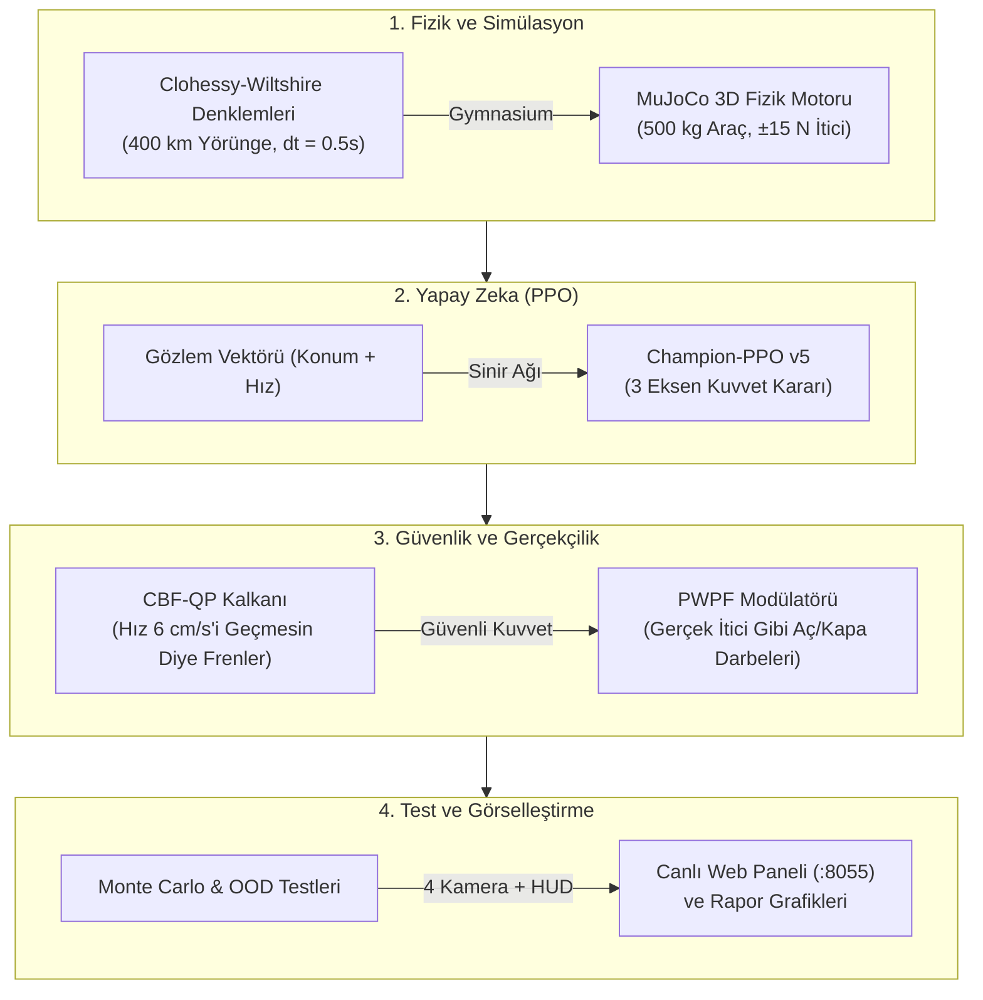

TARGET DECK: data

# 🛰️ Orbital-RL: Otonom Uzay Aracı Kenetlenme Projesi — Proje Raporu

> **Geliştirici:** Nasuhii  
> **Repo:** [github.com/Nasuhii/orbital-rl](https://github.com/Nasuhii/orbital-rl)  
> **Kullanılan Araçlar:** Python, Gymnasium, Stable-Baselines3 (PPO), PyTorch, MuJoCo  
> **Amaç:** Alçak Dünya Yörüngesinde (400 km) bir uzay aracının hedef istasyona çarpmadan, kendi kendine yanaşıp kenetlenmesini öğrenmesi.

---

## 1. Bu Projeyi Neden Yaptık ve Ne Öğrenmeye Çalıştık?

Uzayda iki aracın kenetlenmesi (docking) dışarıdan basit gibi görünse de işin içine girince bayağı zorlayıcı bir problem. Kovalayıcı aracımız **500 kg** ve her eksende en fazla **±15 Newton** itki üretebiliyor. Yani araba gibi aniden frene basıp duramıyoruz; hızlandıysak çok önceden ters yöne itki verip yavaşlamamız gerekiyor.

Başarı kriterlerimiz netti:
- Hedef kenetlenme noktasına **0.14 m (~15 cm)** mesafe içine girmek,
- Temas anındaki hızı **0.06 m/s (6 cm/s)** altında tutmak (yoksa kaza/hasar sayılıyor),
- Yakıtı ($\Delta v$) gereksiz harcamamak.


---

## 2. Sistem Nasıl Çalışıyor? (Kısaca Mimari)

Projeyi 4 ana parçaya bölerek kurduk:




---

## 3. Karşılaştığımız Sorunlar ve Adım Adım Çözümler

Bu projede ilk yazdığımız model hemen çalışmadı; hatta her aşamada yeni bir problemle karşılaştık. Süreç özetle şöyle ilerledi:

### Aşama 1: "Hovering" Sorunu (Liman Önünde Durup Kalma)
İlk denediğimiz klasik PPO modeline (*Naive PPO*) basitçe "yaklaşırsan + puan, çarparsan -100 ceza" dedik. Model de çok zekice ama işimize yaramayan bir açık buldu: Limana 2–3 metre kala tamamen durdu ve süre bitene kadar bekledi. Çünkü çarpmazsa -100 ceza almıyordu! Sonuç: **%0 başarı, %100 hovering**.

**Nasıl çözdük?**
- Mesafeye bağlı bir **hız sınırı eğrisi** ($\tanh$ ile asimptotik hız valisi) ekledik: uzaktayken hızlı gelebilirsin ama yaklaştıkça hızını yavaşça $4\text{–}5\text{ cm/s}$ seviyesine indir.
- Üstüne **PBRS (Potential-Based Reward Shaping)** ekledik; yani araç yerinde durduğunda her saniye az da olsa eksi puan yazıldı. Böylece durmak kârlı olmaktan çıktı.

### Aşama 2: MuJoCo Fiziği, Güvenlik Kalkanı (CBF) ve Gerçekçi İticiler (PWPF)
Çarpışma ve temasları gerçek dünyaya daha yakın test edebilmek için **MuJoCo** 3D fizik motoruna geçtik. Ancak burada hiçbir emniyet önlemi olmadan eğitilen modellerin yarısından fazlası (**%56.7**) limana çok hızlı girip kaza yaptı.

Bunu çözmek için sisteme iki temel parça ekledik:
- **Güvenlik Kalkanı (CBF-QP):** Yapay zeka limana tehlikeli bir hızla yaklaştığında araya girip otomatik olarak fren yaptıran bir emniyet kilidi.
- **Aç/Kapa İtici Dönüştürücü (PWPF):** Gerçek uzay aracı iticileri arabadaki gaz pedalı gibi ara değerler (örneğin 3.5 N) üretemez; ya tamamen **kapalıdır (0 N)** ya da tam güç **açıktır (15 N)**. Bu yüzden modelin istediği sürekli kuvveti kısa aç/kapa darbelerine çeviren bir modülatör kullandık.
- **Behavioral Cloning (BC) Ön Eğitimi:** Model sıfırdan rastgele denemelerle vakit kaybetmesin diye önce klasik bir kontrolcünün örnek uçuşlarını izleterek temel sürüşü öğrettik, sonra PPO ile geliştirdik.

Bu güvenli kontrol yapısıyla (*Integrated Safe-GNC*) yaptığımız **30 farklı rastgele uçuş testinin tamamında (30/30 — %100 başarı)** aracı kazasız şekilde kenetlemeyi başardık (ortalama temas hızı: **0.0441 m/s**).


### Aşama 3: "Model Ezberlemiş mi?" Kontrolü ve `v5` Güncellemesi
`v3` ve `v4` modellerimiz normal testte %100 alıyordu ama içimize sinmediği için bir **X-Ray / OOD (dağılım dışı) test scripti** (`diagnose_overfitting_xray.py`) yazdık. Test edince gördük ki:
- Model sadece istasyonun tam önünden (`+Y` ekseninden) gelmeyi ezberlemiş. Yandan veya arkadan başlatınca (`S5: 360° Fly-Around`) başarı **%0.0**'a düşüyordu.
- Ayrıca kodda 4 tane gizli hata yakaladık: (1) Ödüller çok büyük olduğu için Critic kaybı patlayıp Aktör ağını donduruyormuş, (2) MuJoCo'da kütle değiştirirken `mj_setConst` eksikmiş, (3) Sensör gürültüsü ekledikten sonra `obs[6:9]` temiz veriden kalıyormuş (veri sızıntısı), (4) Canlı hız şoku `data.qvel`'e doğru uygulanmıyormuş.

**`Champion-PPO v5` ile ne yaptık?**
- Bu 4 bug'ı düzelttik ve ödülleri $[-15, +35]$ bandına küçülttük (Critic $R^2$ skoru `0.000`'dan `0.869`'a çıktı).
- Gözlemlerde uzak mesafede körlük olmaması için `asinh + LayerNorm` katmanı ekledik.
- Aracı yandan/arkadan (360°), uzak mesafeden kaçarken (`vy > 0`), kütle/itki arızasıyla ve şoklarla eğittik.

---

## 📊 4. Elde Ettiğimiz Sonuçlar (Özet Tablolar)

### A. 30 Uçuşluk Nominal Monte Carlo (`rl_benchmark_stats.json`)

| Model | Başarı | Hover | Kaza | Son Hız | Son Mesafe | Harcanan $\Delta v$ |
| :--- | :---: | :---: | :---: | :---: | :---: | :---: |
| Naive PPO | `%0.0` | `%100.0` | `%0.0` | `0.835 m/s` | `2.17 m` | `4.06 m/s` |
| PBRS PPO | `%0.0` | `%100.0` | `%0.0` | `0.145 m/s` | `0.48 m` | `1.73 m/s` |
| MuJoCo DR PPO (Kalkansız) | `%0.0` | `%43.3` | `%56.7` | `1.409 m/s` | `2.68 m` | `2.68 m/s` |
| **Integrated Safe-GNC** | **`%100.0`** | **`%0.0`** | **`%0.0`** | **`0.0441 m/s`** | **`0.1375 m`** | **`0.94 m/s`** |

### B. `Champion-PPO v5` Zorlu OOD Testleri (`overfitting_xray_report.json` — 25'er Uçuş)

| Test Senaryosu | `v5` Kalkansız (`Pure-Raw`) | `v5` Kalkanlı (`CBF+PWPF`) | Notlar |
| :--- | :---: | :---: | :--- |
| **S1: Normal Başlangıç (ID)** | **`%100.0`** | **`%100.0`** | Ortalama $\Delta v = 0.577\text{ m/s}$ |
| **S2: ±%35 Kütle + %40 İtici Arızası** | **`%100.0`** | **`%100.0`** | Arızaya rağmen tam başarı |
| **S3: Yüksek Gürültü + ±4cm Bias + Gecikme** | `%60.0` | `%56.0` | Tek zayıf nokta (aşağıda açıklandı) |
| **S4: 30–50m Uzaktan Kaçış (`vy > 0`)** | **`%100.0`** | **`%96.0`** | Kaçan hedefi yakalayıp kenetlendi |
| **S5: 360° Yandan / Arkadan Yaklaşma** | **`%100.0`** | **`%88.0`** | Eski modelde `%0` idi! |
| **S6: Uçuş Sırasında Çift Hız Şoku** | **`%100.0`** | **`%100.0`** | Darbeden sonra toparladı |
| **OOD Ortalama Başarı** | **`%92.0`** | **`%88.0`** | Genelleme boşluğu sadece `%8.0` |

> **Dürüst Not (Eksik Kalan Kısım):** S3 senaryosunda (çok yüksek sensör gürültüsü + 0.5 sn gecikme + sabit bias) model tek karelik gözleme baktığı için zorlanıyor (`%60`). Bir sonraki aşamada (v6) son 4–8 adımın geçmişini tutan **Frame Stacking** veya **LSTM / Kalman Filtresi** eklenirse burası da rahatça %90+ seviyesine çıkarılabilir.

---

## 📸 5. Simülasyondan Görseller


| Chase Cam | FPV Probe Cam | Station CCTV | Orbital Tactical |
| :---: | :---: | :---: | :---: |
|  |  |  |  |

---

## 🚀 6. Projeyi Nasıl Çalıştırırsınız?

```bash
# Canlı 30 FPS MuJoCo web arayüzünü açmak için (http://localhost:8055/):
python mujoco_live_server.py 8055

# Zorlu OOD testlerini tekrar çalıştırmak için:
python diagnose_overfitting_xray.py
```

### Projeden Çıkardığımız En Önemli Dersler
1. **Eğitimde %100 almak yetmiyor:** Mutlaka eğitimde hiç görmediği açılardan ve arıza senaryolarıyla (OOD) test etmek gerekiyor.
2. **Ödül ölçeği ve veri sızıntısı çok kritik:** Ödüller büyük olunca PPO'nun Critic ağı bozulup öğrenmeyi kilitleyebiliyor; ayrıca gürültülü veriden türetilen değişkenleri yeniden hesaplamazsak model kopya çekiyor.
3. **Güvenlik kalkanı şart:** Yapay zeka tek başına iyi gitse bile son anda hata yapabilir; araya deterministik bir CBF kalkanı koymak gerçek sistemler için çok daha güvenli.

---

## 🃏 Anki Kartları

START
Temel
TARGET DECK: data
Ön: Orbital-RL projesinde `v5` modelinin S3 (yüksek sensör gürültüsü + gecikme) senaryosunda %60'ta kalmasının temel sebebi nedir ve nasıl çözülür?
Geri: Model tek adımlı (Markovian) gözlem kullandığı için gürültü ve gecikmeyi filtreleyemez. Son 4–8 adımın geçmişini veren Frame Stacking, LSTM veya Kalman Filtresi ile çözülür.
Tags: from_obsidian, data, rl, orbital_rl
END
