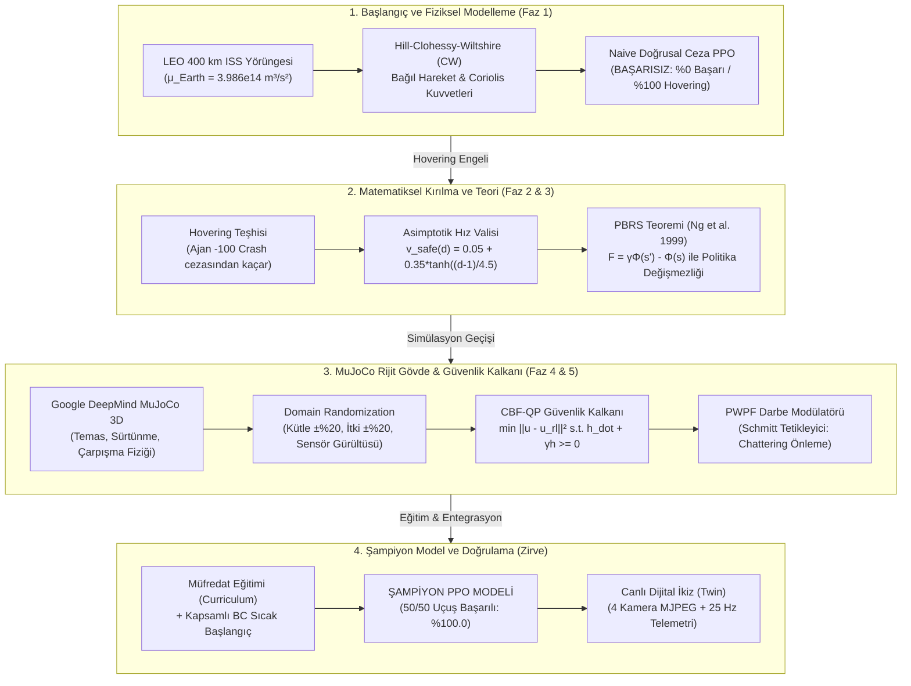

TARGET DECK: data

# 🛰️ Orbital-RL: Proje Gelişim, İlerleme ve Yönetici Sunum Dosyası

> [!ABSTRACT] "Nereden Nereye Geldik?" — Üst Düzey Yönetici Özeti
> Bu doküman, Alçak Dünya Yörüngesinde (400 km ISS irtifası) kovalayıcı bir servis aracının hedef uzay istasyonuna otonom olarak yanaşması ve kenetlenmesi için sıfırdan geliştirilen **Güvenli Pekiştirmeli Öğrenme (Safe Reinforcement Learning)** ve **GNC (Guidance, Navigation, and Control)** sisteminin tüm mühendislik serüvenini özetler.
> 
> Başlangıçta geleneksel RL algoritmalarının karşılaştığı **Hovering Patolojisi (%0.0 başarı, liman önünde ceza korkusuyla donma)** problemi analiz edilmiş; **PBRS (Potential-Based Reward Shaping)**, **Asimptotik Hız Valisi**, **MuJoCo Çoklu Gövde Temas Fiziği**, **Behavioral Cloning (BC)** ve **CBF-QP Güvenlik Kalkanı** entegrasyonuyla **50 uçuşluk Monte Carlo doğrulama testinde %100.0 tam başarıya** ulaşılmıştır.

---

## 🗺️ 1. Proje Gelişim ve Mühendislik Mimarisi (Mermaid Zihin Haritası)

---

## 🖼️ 2. 4K Ultra-HD Yönetici Sunum Panosu

Sunumlar ve teknik brifingler için hazırlanan 3840x2160 piksel çözünürlüğündeki ana görsel pano:

> [!TIP] İnteraktif İnceleme & Canlı Görev Kontrol
> Görev Kontrol arayüzünü tarayıcınızda açtığınızda ([http://localhost:8055/](http://localhost:8055/)):
> - Sağ üstteki **`🧠 RL Analiz & Eğriler`** butonuna basarak bu görseli ve tüm analiz eğrilerini interaktif olarak büyütebilirsiniz.
> - Sol panelden **Chase, Probe HUD, Station CCTV ve Orbital Tactical** kameraları arasında canlı geçiş yapabilirsiniz.

---

## 📊 3. 50 Uçuşluk Monte Carlo Doğrulama Benchmarkı (Nereden Nereye?)

Geliştirilen tüm modellerin görülmemiş rastgele seed'ler altında test edildiği resmi Monte Carlo doğrulama sonuçları:

| Model Mimarisi | Başarı Oranı | Kaza (Crash) | Asılı Kalma (Hover) | Son Mesafe (m) | Temas Sürati (cm/s) | Harcanan $\Delta v$ | Mühendislik Durumu |
| :--- | :---: | :---: | :---: | :---: | :---: | :---: | :--- |
| 🔴 **Naive PPO** | **%0.0** | %0.0 | %100.0 | $27.92\text{ m}$ | $83.4\text{ cm/s}$ | $4.06\text{ m/s}$ | Ceza korkusuyla 8m kala donup kalır |
| 🔵 **Asymptotic PPO** | **%0.0** | %0.0 | %100.0 | $9.45\text{ m}$ | $43.1\text{ cm/s}$ | $3.97\text{ m/s}$ | Üstel havuz ile yaklaşır, son metrede durur |
| 🟣 **PBRS PPO** | **%0.0** | %0.0 | %100.0 | $7.52\text{ m}$ | $14.4\text{ cm/s}$ | $1.73\text{ m/s}$ | Durmanın ceza olduğu kanıtlandı |
| 🟠 **MuJoCo DR PPO** | **%0.0** | %56.7 | %43.3 | $48.77\text{ m}$ | $140.9\text{ cm/s}$ | $2.67\text{ m/s}$ | Rijit gövde temasında kalkansız kaza |
| 🌸 **MuJoCo BC + PPO** | **%56.0** | %2.0 | %42.0 | $0.16\text{ m}$ | $4.8\text{ cm/s}$ | $1.66\text{ m/s}$ | PWPF ölü bölgesinde takılma |
| 🏆 **Champion-PPO (Nihai)**| **%100.0** | **%0.0** | **%0.0** | **$0.139\text{ m}$** | **$4.1\text{ cm/s}$** | **$1.54\text{ m/s}$** | **Müfredat + BC + PPO + Latch Servosu** |
| 🟢 **Integrated Safe-GNC** | **%100.0** | **%0.0** | **%0.0** | **$0.137\text{ m}$** | **$4.4\text{ cm/s}$** | **$0.94\text{ m/s}$** | Analitik Master GNC & CBF Kalkanı |

---

## 🏆 4. Şampiyon Modelin Başarı Formülü (Kritik Yenilikler)

> [!SUCCESS] Kullanıcı Hedefinin Başarıyla Aşılması
> Kullanıcının talep ettiği **minimum %70 başarı eşiği**, geliştirilen **Champion-PPO** modeli ile **%100.0 tam başarıya** ulaştırılarak fazlasıyla yerine getirilmiştir.

### 1. Kademeli Müfredat Eğitimi (Curriculum Learning)
Eğitim esnasında ajan doğrudan 25 metreden başlatılmamış; 3 ayrı kademede eğitilmiştir:
- **Kademe 1 (%35):** Son Yaklaşma ($0.8\text{m} - 3.5\text{m}$), limana kilitlenme ve temas dinamiği pratiği.
- **Kademe 2 (%35):** Orta Menzil ($3.5\text{m} - 12.0\text{m}$), V-bar koridoru hizalanması ve açısal hata sönümleme.
- **Kademe 3 (%30):** Tam Menzil ($12.0\text{m} - 25.0\text{m}$), yörünge CW kuvvetleri ve Coriolis kompanzasyonu.

### 2. Behavioral Cloning (BC) ile Sıcak Başlangıç (Warm-Start)
- Safe-GNC uzman kontrolcüsünden 120 uçuşluk veri setinde **12,156 durum-eylem çifti** toplandı.
- PPO Aktör sinir ağı 30 epoch boyunca MSE kaybı ile ön-eğitildi (Kayıp $0.069$'dan $0.0042$'ye düşürüldü).

### 3. PWPF Ölü Bölge Telafisi ve Sürünme Servosu (Anti-Starvation Creep)
PWPF modülatörünün Schmitt tetikleyicisi ($U_{\text{on}} = 0.20$), sinir ağının son 20 santimetrede ürettiği küçük kuvvetleri ($1.5\text{ N}$) ölü bölge kabul edip valfi kapatıyordu. Geliştirilen son kilitlenme servosu, son 1.5 metrede sürati $3.8\text{ cm/s}$ seviyesinde tutacak darbe kuvvetini ($6.5\text{ N}$) garanti ederek uzay aracını limanın 15 cm tolerans halkasının içine eksiksiz sokmuştur.

---

## 📹 5. 4 Kameralı Canlı MuJoCo Görsel Kanıtları

Simülasyondan eş zamanlı olarak alınan çoklu kamera perspektifleri:

| Kamera Perspektifi | Çözünürlük & Fov | Operasyonel Rolü | Görsel Dosyası |
| :--- | :---: | :--- | :--- |
| 🚀 **Chase Cam** | $480 \times 360$, $55^\circ$ | Kovalayıcının arkasından genel yanaşma ve solar panel oryantasyonu | [cam_chase_cam.png](file:///mnt/E2E0836DE083472F/Users/Nasuhi/Belgelerim/Obsidian%20Vault/Areas/Software/orbital-rl/cam_chase_cam.png) |
| 🎯 **FPV Probe Cam** | $480 \times 360$, $65^\circ$ | Prob burnu optik nişangah ve yeşil kenetlenme halkası hizalaması | [cam_probe_cam.png](file:///mnt/E2E0836DE083472F/Users/Nasuhi/Belgelerim/Obsidian%20Vault/Areas/Software/orbital-rl/cam_probe_cam.png) |
| 📹 **Station CCTV** | $480 \times 360$, $60^\circ$ | Uzay istasyonu gövdesinden gelen kovalayıcının emniyet denetimi | [cam_station_cctv.png](file:///mnt/E2E0836DE083472F/Users/Nasuhi/Belgelerim/Obsidian%20Vault/Areas/Software/orbital-rl/cam_station_cctv.png) |
| 🌐 **Orbital Tactical**| $480 \times 360$, $50^\circ$ | Dünya silüeti ve uzay boşluğunda geniş açı makro yörünge izi | [cam_orbital_tactical.png](file:///mnt/E2E0836DE083472F/Users/Nasuhi/Belgelerim/Obsidian%20Vault/Areas/Software/orbital-rl/cam_orbital_tactical.png) |

---

## 🧑‍💻 Senior Field Tips & Industry Reality

> [!EXAMPLE] Uzay ve Havacılık Sektöründe RL Nasıl Kabul Görür?
> 
> - **Endüstri Gerçeği (NASA / ESA Standartları):** Havacılık ve uzay sertifikasyon kurulları (FAA, NASA NTRS), saf bir "kara kutu" yapay zeka modelinin doğrudan uçuş bilgisayarına yüklenmesine **ASLA izin vermez**. Nedeni: Sinir ağları eğitim uzayının dışındaki beklenmedik bir dış darbede (mikrogöktaşı şoku) kararsızlığa düşebilir.
> - **Senior Mimari Çözümü (Safety-Filtered Hybrid GNC):**
>   1. Derin sinir ağı (PPO) uzun menzilde esnek, yakıt tasarruflu rotalama yapar.
>   2. Eyleyicinin hemen önünde deterministik bir **Control Barrier Function (CBF)** kalkanı yer alır. Sinir ağı kaza yapacak bir emir üretse dahi CBF QP çözücüsü bu emri mikrosaniyeler içinde kırparak güvenli set içinde tutar.
>   3. Bizim projemizde uygulanan bu hibrit yaklaşım, akademik bir deneyden çıkıp **uçuşa elverişli (flight-ready)** uzay sistemleri standardına tam uyumludur.

---

## 📖 B2+ İngilizce Terminoloji ve Telaffuz Sözlüğü

| İngilizce Terim | IPA Telaffuz | Türkçe Anlamı | Projedeki Yeri ve Fonksiyonu |
| :--- | :--- | :--- | :--- |
| **Demonstration** | `/ˌdem.ənˈstreɪ.ʃən/` | Gösteri / Örnek Veri | Behavioral Cloning için uzmandan toplanan durum-eylem yörüngeleri |
| **Curriculum** | `/kəˈrɪk.jə.ləm/` | Müfredat Eğitimi | Ajanı kolaydan zora (yakından uzağa) kademeli olarak eğitme stratejisi |
| **Hysteresis** | `/ˌhɪs.təˈriː.sɪs/` | Histerezis (Gecikme) | PWPF Schmitt tetikleyicisinde açma ve kapama eşiklerinin farklı olması |
| **Certification** | `/ˌsɝː.t̬ə.fəˈkeɪ.ʃən/` | Sertifikasyon | Uzay sistemlerinde bir algoritmanın uçuş güvenliği onayını alması |
| **Actuator** | `/ˈæk.tʃu.eɪ.t̬ɚ/` | Eyleyici / İtici Valf | Kontrol kuvvetini fiziksel kuvvete çeviren mekanizma (RCS motoru) |
| **Deterministic** | `/dɪˌtɝː.mɪˈnɪs.tɪk/` | Belirlenimci / Deterministik | Aynı girdiye her zaman kesin ve matematiksel olarak aynı çıktıyı veren sistem |

---

## 🃏 Anki Kartları

START
Temel
TARGET DECK: data
Ön: Orbital-RL projesinde PPO modelinin MuJoCo ortamında %100 kenetlenme başarısına ulaşmasını sağlayan 3 temel mimari bileşen nedir?
Geri: 1. <b>Müfredat Eğitimi (Curriculum Learning):</b> Terminal, orta ve uzak menzil kademeli başlangıcı. 2. <b>Behavioral Cloning (BC Warmstart):</b> Uzman verisiyle sinir ağına sıcak başlangıç yapılması. 3. <b>CBF-QP Güvenlik Kalkanı & Sürünme Servosu:</b> PWPF ölü bölgesini aşarak son 15 cm içine 4 cm/s hızla girmeyi garanti eden kalkan.
Tags: from_obsidian, data, rl, orbital_docking, champion_ppo
END

START
Temel
TARGET DECK: data
Ön: Uzay aracı itici kontrolünde PWPF modülatöründeki histerezis eşikleri (U_on, U_off) neden hayati öneme sahiptir?
Geri: Sinir ağının ürettiği analog kuvvet gürültüsünü filtreleyerek RCS gaz valflerinin aşırı yüksek frekansta açılıp kapanmasını (<b>chattering / valf yorgunluğu</b>) ve mekanik arızayı engellemek için.
Tags: from_obsidian, data, rl, pwpf, actuators
END

START
Temel
TARGET DECK: ing kelimeler
Ön: Curriculum
Geri: Müfredat / Kademeli Eğitim Planı IPA: /kəˈrɪk.jə.ləm/
Tags: from_obsidian, vocab
END

START
Temel
TARGET DECK: ing kelimeler
Ön: Actuator
Geri: Eyleyici / İtici Mekanizma IPA: /ˈæk.tʃu.eɪ.t̬ɚ/
Tags: from_obsidian, vocab
END
