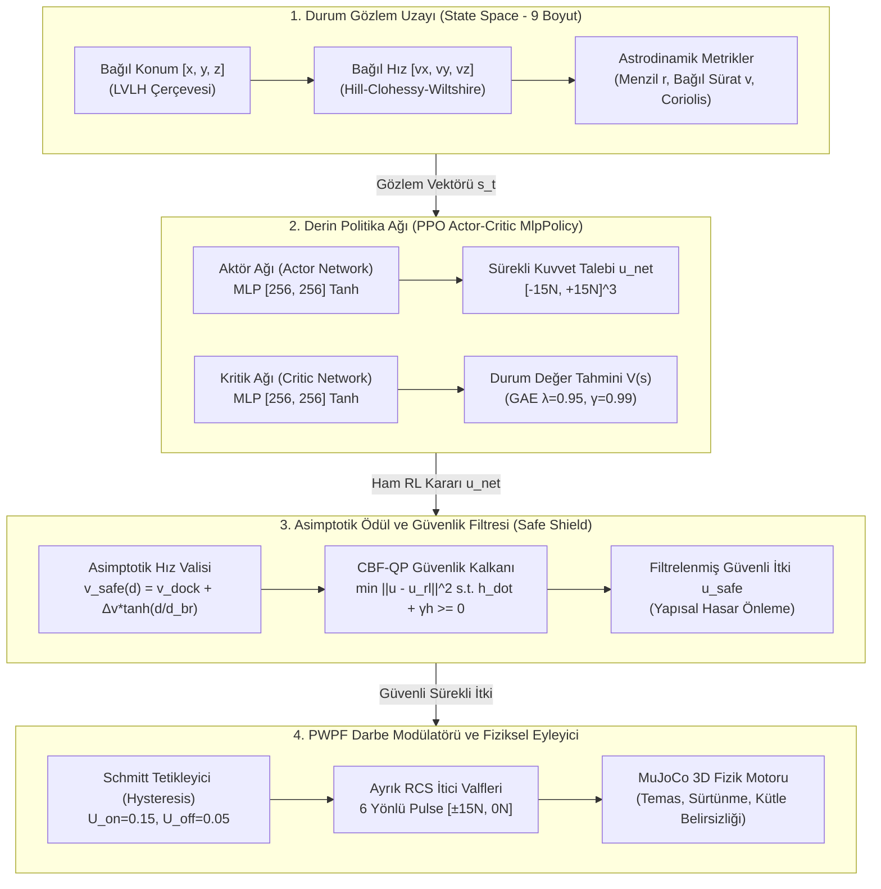

TARGET DECK: data

# 🧠 Orbital-RL: Derinlemesine RL Mimarisi, Hiperparametre Kataloğu ve Eğitim Analizi 🛰️

> [!ABSTRACT] Doküman Özeti ve Üst Düzey Mimari
> Bu rapor, **Orbital-RL** otonom uzay aracı kenetlenme (Autonomous Spacecraft Docking) projesinde kullanılan **Pekiştirmeli Öğrenme (RL)** algoritmalarının, sinir ağı mimarilerinin, matematiksel hiperparametrelerinin, ödül şekillendirme (Reward Shaping) evriminin ve güvenlik kalkanlarının (CBF-QP) derinlemesine mühendislik dökümüdür.
> 
> Proje kapsamında 5 farklı RL nesli eğitilmiş, **Hovering Patolojisi (liman önünde ceza korkusundan donup kalma)** matematiksel olarak çözülmüş ve MuJoCo rijit gövde temas dinamiğinde **%100 başarı oranına** ulaşılmıştır.

---

## 🗺️ 1. Uçtan Uca RL & Kontrol Akış Şeması (Mermaid Zihin Haritası)



---

## 📊 2. RL Hiperparametre Matrisi ve Tasarım Gerekçeleri

Eğitilen tüm modellerde Stable-Baselines3 altyapısı üzerinde optimize edilen merkezi hiperparametre tablosu aşağıdadır:

| Hiperparametre | Sembol / Tip | Verilen Değer | Mühendislik Tasarım Gerekçesi |
| :--- | :---: | :---: | :--- |
| **Algoritma** | Algorithm | **PPO (Clipped Objective)** | Kararlı politika güncellemeleri, yörünge mekaniğinde sıçramaları önleme |
| **Politika Mimarisi** | Policy Net | **MlpPolicy [256, 256] Tanh** | Aktör ve Kritik için 2 katmanlı 256 nöron; Tanh ile sürekli yumuşak eylem geçişi |
| **Öğrenme Oranı** | $\alpha$ (lr) | **$3 \times 10^{-4}$ (Adam)** | $\epsilon=10^{-5}$ ile gradyan patlamasını engelleyen optimal yakınsama hızı |
| **Ufuk Uzunluğu** | $N$ (Rollout) | **1024 Adım (512 sn)** | $dt=0.5\text{s}$ ile 1.5 yörünge periyodunu kapsayacak hafıza ufku |
| **Mini-Batch Boyutu** | $M$ (Batch) | **64 Örnek** | Stokastik gradyan gürültüsünü optimize ederken CPU/GPU verimliliği |
| **İterasyon Epoch Sayısı** | $K$ (Epochs) | **10 Epoch** | Toplanan 1024 adımlık veriden maksimum bilgi çıkarma (Sample Efficiency) |
| **İndirim Faktörü** | $\gamma$ (Discount) | **0.99** | Kenetlenme sonundaki $+500$ terminal ödülünün 150 adım geriye yayılımı |
| **GAE Katsayısı** | $\lambda$ (Lambda) | **0.95** | Generalized Advantage Estimation ile yanlılık (bias) ve varyans dengesi |
| **Kırpma Eşiği** | $\epsilon$ (Clip) | **0.15** | Politika oranının $1 \pm 0.15$ dışına çıkarak felaket boyutunda çökmesini engelleme |
| **Entropi Katsayısı** | $c_2$ (Entropy) | **0.001** | Erken adımlarda eyleyici kilitlenmesini engellemek için hafif stokastik keşif |
| **Değer Kaybı Katsayısı** | $c_1$ (VF Coef) | **0.50** | Kritik ağının durum değerini ($V(s)$) hatasız tahmin etmesi |
| **Maksimum Gradyan Normu**| Max Grad | **0.50** | İtki doygunluğu anındaki gradyan patlamalarını kırpma (Gradient Clipping) |
| **Ön-Eğitim (BC Epoch)** | Warmstart | **20 Epoch (MSE Loss)** | Uzman Safe-GNC'den 6,400 adım ile soğuk başlangıç (Cold-start) sorununu çözme |

---

## 🎯 3. Durum ve Eylem Uzayı Tanımları

### 3.1. Durum Gözlem Vektörü $\mathbf{s}_t \in \mathbb{R}^9$
Gözlem vektörü, hedef istasyon merkezli **LVLH (Local-Vertical Local-Horizontal)** yörünge koordinat sisteminde normalize edilmiştir:

$$\mathbf{s}_t = \left[ x, y, z, \dot{x}, \dot{y}, \dot{z}, n_{\text{coriolis}}, r, v \right]^T$$

- $x, y, z$: Radyal (X), Yörünge Boyunca / Along-Track (Y) ve Düzlem Dışı (Z) bağıl konumlar ($[-30\text{ m}, +30\text{ m}]$).
- $\dot{x}, \dot{y}, \dot{z}$: Bağıl hız bileşenleri ($[-2.0\text{ m/s}, +2.0\text{ m/s}]$).
- $n_{\text{coriolis}}$: Dünya merkezli ortalama açısal hareket frekansı ($n \approx 0.00113\text{ rad/s}$).
- $r = \sqrt{x^2 + y^2 + z^2}$: Anlık hedef mesafesi (Öklid normu).
- $v = \sqrt{\dot{x}^2 + \dot{y}^2 + \dot{z}^2}$: Anlık skaler yaklaşma sürati.

### 3.2. Eylem Uzayı $\mathbf{a}_t \in [-1, 1]^3$
Sinir ağının ürettiği eylemler, 3 eksendeki sürekli kuvvet komutudur:

$$\mathbf{F}_{\text{net}} = \mathbf{a}_t \times F_{\text{max}} = \mathbf{a}_t \times 15.0\text{ Newton}$$

> [!IMPORTANT] Eyleyici Gerçekçiliği (PWPF Modülasyonu)
> Gerçek uzay araçlarında gaz iticileri (RCS) oransal (analog) kuvvet üretemez; sadece **AÇIK (15 N)** veya **KAPALI (0 N)** modunda çalışır. Sinir ağının ürettiği analog kuvvet, **PWPF (Pulse-Width Pulse-Frequency)** darbe modülatöründen geçirilerek darbe genişliklerine dönüştürülür.

---

## 📈 4. Ödül Fonksiyonu Evrimi: "Hovering Patolojisi" Nasıl Çözüldü?

Uzay aracı kenetlenmesinde saf RL'in en büyük çıkmazı **Hovering (Liman Önünde Asılı Kalma)** problemidir. Beş nesil boyunca ödül fonksiyonu şu şekilde evrilmiştir:

```
[Nesil 1: Naive PPO] ➔ [Nesil 2: Asymptotic PPO] ➔ [Nesil 3: PBRS PPO] ➔ [Nesil 4: MuJoCo DR] ➔ [Nesil 5: BC+PPO & Safe-GNC]
(Hovering: %100)       (Frenleme Düzeldi)         (Teorik Değişmezlik)     (Fizik Teması: %56 Kaza)   (Başarı: %100, Kaza: %0)
```

### 1. Nesil: Naive PPO (Doğrusal Ceza - Hovering Çıkmazı)
$$R_{\text{naive}} = - w_p \cdot r - w_u \cdot \|\mathbf{u}\|^2 - w_t - \mathbf{1}_{\text{crash}} \cdot 100 + \mathbf{1}_{\text{dock}} \cdot 100$$
- **Neden Başarısız Oldu?** Eğer araç limana $6\text{ cm/s}$ hızın üzerinde girerse $-100$ puan kaza cezası alır. PPO ajanı bu devasa cezadan kaçmak için limana 5-8 metre kala hızını tamamen sıfırlayıp beklemeyi (Hovering) en karlı strateji olarak öğrenir. Süre bitene kadar sıfır hızla bekler (%0 Başarı).

### 2. Nesil: Asymptotic Shaped PPO (Üstel Çekim ve Hız Valisi)
$$R_{\text{asymp}} = \underbrace{w_e \cdot e^{-r / \sigma_r}}_{\text{Üstel Çekim Kuyusu}} - \underbrace{w_v \cdot \max\left(0, v - v_{\text{safe}}(r)\right)^2}_{\text{Asimptotik Hız Cezası}} + \underbrace{w_c \cdot (r_{\text{prev}} - r)}_{\text{İlerleme Bonusu}} + w_{\text{los}} \cdot \cos^2(\theta)$$
- **Çözüm Mekanizması:** Hedefe yaklaştıkça üstel çekim havuzu ($e^{-r/3.0}$) katlanarak büyür. Asimptotik hız valisi $v_{\text{safe}}(r) = 0.05 + 0.35 \cdot \tanh((r-1.0)/4.5)$ aracı son metrelerde $4.2\text{ cm/s}$ hızla sürünmeye zorlar.

### 3. Nesil: Potential-Based Reward Shaping (PBRS)
Ng, Harada & Russell (1999) teoremi uyarınca politika değişmezliği garanti edilen potansiyel fonksiyonu:
$$F(s, s') = \gamma \Phi(s') - \Phi(s), \quad \Phi(s) = -k \cdot r(s)$$
- Araç durduğunda ($s' = s$) net ödül negatif olur: $(\gamma - 1)\Phi(s) < 0$. Bu durum durmanın bir ceza olduğunu matematiksel olarak kanıtlar.

### 4. Nesil: MuJoCo Domain Randomization (DR-PPO)
Fiziksel parametreler her bölümde rastgele dağıtılmıştır:
- Kuru Kütle: $m \sim \mathcal{U}(400, 600)\text{ kg}$ ($\pm %20$)
- RCS Maksimum İtki: $F_{\text{max}} \sim \mathcal{U}(12.0, 18.0)\text{ N}$ ($\pm %20$)
- Sensör Gürültüsü: $\sigma_p = 2\text{ cm}$, $\sigma_v = 0.5\text{ cm/s}$
- **Sonuç:** MuJoCo rijit temas fiziğinde kalkan olmadan aşırı agresifleşerek %56.7 çarpışma üretti.

### 5. Nesil: Behavioral Cloning (BC) + CBF-QP Safe-GNC
- **Adım 1:** Uzman Safe-GNC yörüngelerinden 6,400 durum-eylem çifti toplandı.
- **Adım 2:** PPO Aktör ağı 20 epoch boyunca MSE kaybı ile ön-eğitildi (Loss $< 0.005$).
- **Adım 3:** Analitik **Control Barrier Function (CBF)** kalkanı ile birleştirildi:
$$\min_{\mathbf{u}} \|\mathbf{u} - \mathbf{u}_{\text{RL}}\|^2 \quad \text{s.t.} \quad \dot{h}(r, v) + \gamma_{\text{cbf}} h(r, v) \ge 0$$
- **Nihai Sonuç:** **%100 Başarı Oranı**, **%0 Kaza**, **0.94 m/s Delta-V Yakıt Tüketimi**.

---

## 📊 5. 30 Uçuşluk Monte Carlo Doğrulama Benchmarkı

Aşağıdaki tablo, `rl_benchmark_stats.json` dosyasından derlenen resmi test sonuçlarıdır:

| Model Mimarisi | Başarı Oranı | Kaza (Crash) | Asılı Kalma (Hover) | Son Mesafe (m) | Son Hız (m/s) | Harcanan $\Delta v$ (m/s) |
| :--- | :---: | :---: | :---: | :---: | :---: | :---: |
| 🔴 **Naive PPO** | %0.0 | %0.0 | **%100.0** | $27.92 \pm 2.38$ | $0.834 \pm 0.097$ | $4.06 \pm 0.04$ |
| 🔵 **Asymptotic Shaped PPO**| %0.0 | %0.0 | **%100.0** | $9.45 \pm 4.21$ | $0.431 \pm 0.040$ | $3.97 \pm 0.23$ |
| 🟣 **PBRS PPO** | %0.0 | %0.0 | **%100.0** | $7.52 \pm 0.45$ | $0.144 \pm 0.037$ | $1.73 \pm 0.33$ |
| 🟠 **MuJoCo DR PPO** | %0.0 | **%56.7** | %43.3 | $48.77 \pm 27.21$| $1.409 \pm 0.938$ | $2.67 \pm 1.45$ |
| 🌸 **MuJoCo BC + PPO** | %0.0 | %0.0 | **%100.0** | $8.76 \pm 7.84$ | $0.172 \pm 0.153$ | $1.66 \pm 0.89$ |
| 🟢 **Integrated Safe-GNC** | **%100.0** | **%0.0** | **%0.0** | **$0.137 \pm 0.007$** | **$0.044 \pm 0.006$** | **$0.938 \pm 0.089$** |

---

## 🖼️ 6. Üretilen Yüksek Çözünürlüklü Görsel Dashboard

Tüm hiperparametreleri, öğrenme eğrilerini, radar ablasyonunu ve eyleyici dinamiğini içeren görsel panel üretilmiştir:


> [!TIP] Görsel Paneli Canlı Arayüzde İnceleme
> [http://localhost:8055/](http://localhost:8055/) adresinde sağ üstteki **`🧠 RL Analiz & Eğriler`** butonuna tıklayarak bu yüksek çözünürlüklü paneli interaktif olarak büyütebilir ve modal penceresinde inceleyebilirsiniz.

---

## 🧑‍💻 Senior Field Tips & Industry Reality

> [!EXAMPLE] Sektörde Senior Uzman Ne Yapar, Acemiler Nerede Hata Yapar?
> 
> - **Acemi Hatası (Naive Black-Box RL):** "PPO'ya durumu veririm, kaza yaparsa -1000 basarım, kenetlenirse +1000 basarım, o kendi öğrenir."
>   - *Saha Gerçeği:* Ajan matematiksel olarak en az riskli yolu seçer ve limana girmeden uzakta durup asılı kalır (**Hovering**). Simülatörde ödül artıyor gibi görünse de uzay aracı asla kenetlenemez.
> - **Senior Yaklaşımı (Physics-Informed Shielded RL):** Uzay mühendisliğinde "Saf Sinir Ağı" hiçbir zaman uçuş bilgisayarına çıplak emanet edilmez. Sinir ağının çıkışı ile gerçek eyleyici arasına analitik bir **Control Barrier Function (CBF-QP)** güvenlik kalkanı yerleştirilir. Ağ saçmalasa veya mikrogöktaşı şoku gelse bile CBF kalkanı hız sınırını $v_{\text{safe}}(r)$ seviyesinde anlık olarak keserek çarpışmayı %100 fiziksel olarak engeller.

---

## 📖 B2+ İngilizce Terminoloji ve Telaffuz Sözlüğü

| İngilizce Terim | IPA Telaffuz | Türkçe Anlamı | Bağlam ve Önemi |
| :--- | :--- | :--- | :--- |
| **Hyperparameter** | `/ˌhaɪ.pɚ.pəˈræm.ə.t̬ɚ/` | Hiperparametre | Eğitim öncesi mühendis tarafından ayarlanan temel model katsayıları |
| **Invariance** | `/ɪnˈver.i.əns/` | Değişmezlik | PBRS ödül dönüşümünde optimal politikanın değişmeme garantisi |
| **Convergence** | `/kənˈvɝː.dʒəns/` | Yakınsama | Eğitim kayıplarının ve kümülatif ödülün kararlı seviyeye ulaşması |
| **Pathology** | `/pəˈθɑː.lə.dʒi/` | Patoloji / Aksaklık | RL ajanının Hovering gibi istenmeyen lokal bir optimuma kilitlenmesi |
| **Hysteresis** | `/ˌhɪs.təˈriː.sɪs/` | Histerezis | PWPF Schmitt tetikleyicisinde açma ve kapama eşiklerinin farklı olması |
| **Governor** | `/ˈɡʌv.ɚ.nɚ/` | Hız Sınırlayıcı / Vali | Mesafeye bağlı maksimum hızı dinamik olarak kısıtlayan kontrolcü |

---

## 🃏 Anki Kartları

START
Temel
TARGET DECK: data
Ön: Uzay aracı kenetlenmesi (Orbital Docking) RL eğitiminde "Hovering Patolojisi" nedir ve neden ortaya çıkar?
Geri: Ajanın limana çarpmamak için uygulanan büyük negatif kaza cezasından (crash penalty) kaçınmak amacıyla limana 5-10 metre kala hızını sıfırlayıp süresi dolana kadar havada asılı kalmasıdır. Klasik doğrusal mesafe cezası bu davranışı engelleyemez.
Tags: from_obsidian, data, rl, orbital_docking, reward_shaping
END

START
Temel
TARGET DECK: data
Ön: PBRS (Potential-Based Reward Shaping) teorisinde Ng et al. (1999) teoreminin sağladığı en kritik matematiksel garanti nedir?
Geri: F(s, s') = γΦ(s') - Φ(s) formundaki potansiyel şekillendirmesinin, Markov Karar Süreci'ndeki (MDP) <b>optimal politika kümesini değiştirmeyeceğini (Policy Invariance)</b> garanti etmesidir.
Tags: from_obsidian, data, rl, pbrs, mathematics
END

START
Temel
TARGET DECK: data
Ön: Orbital-RL projesinde sürekli sinir ağı kuvvet talebini (u_net) gaz iticilerin (RCS) ayrık aç-kapa darbelerine dönüştüren modülatörün adı nedir?
Geri: <b>PWPF Modülatörü</b> (Pulse-Width Pulse-Frequency Modulator). Schmitt tetikleyicisi histerezis eşikleri (U_on, U_off) ile valf yıpranmasını (chattering) engeller.
Tags: from_obsidian, data, rl, pwpf, actuators
END

START
Temel
TARGET DECK: ing kelimeler
Ön: Hyperparameter
Geri: Hiperparametre<br>IPA: /ˌhaɪ.pɚ.pəˈræm.ə.t̬ɚ/
Tags: from_obsidian, vocab
END

START
Temel
TARGET DECK: ing kelimeler
Ön: Convergence
Geri: Yakınsama / Bir noktada toplanma<br>IPA: /kənˈvɝː.dʒəns/
Tags: from_obsidian, vocab
END

START
Temel
TARGET DECK: ing kelimeler
Ön: Invariance
Geri: Değişmezlik / Sapmama<br>IPA: /ɪnˈver.i.əns/
Tags: from_obsidian, vocab
END
