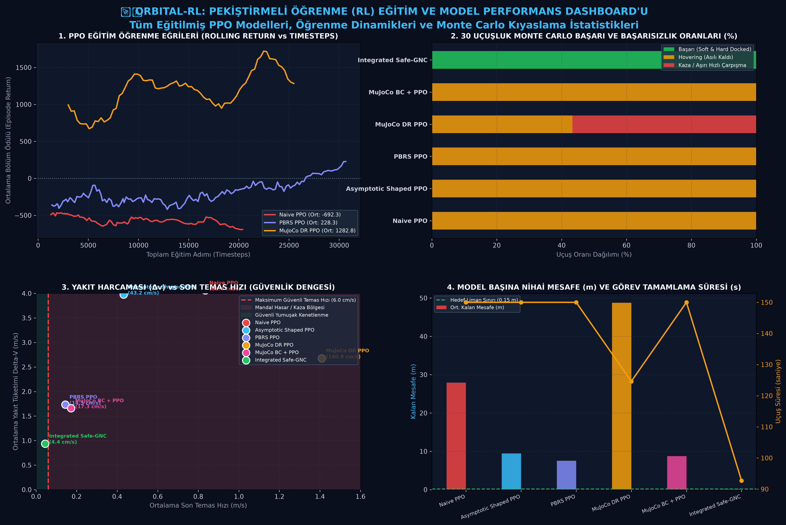

TARGET DECK: data

# 🧠 Orbital-RL: Yapay Zeka Model Eğitimi, Kapsamlı İstatistikler ve RL Altyapı Raporu

> **Proje Deposu:** [github.com/Nasuhii/orbital-rl](https://github.com/Nasuhii/orbital-rl) 🔒  
> **RL Kütüphanesi:** Stable-Baselines3 v2.9.2 + PyTorch v2.15 + Gymnasium v1.4.0  
> **Fizik Simülatörü:** Google DeepMind MuJoCo v3.17 & 3D Clohessy-Wiltshire RK4  
> **Geliştirici & GNC Araştırmacısı:** Nasuhii  
> **Eğitilen Model Sayısı:** 6 Farklı PPO ve Hibrit Güvenlik Mimarisi  
> **Doğrulama Testi:** 30 Uçuşluk Rastgele Tohumlu Monte Carlo Dayanıklılık Kıyaslaması  

---

## 🧭 1. Mimari Zihin Haritası (Mermaid Subgraph Standardı)

```mermaid
flowchart TD
    subgraph G1["1. Fizik ve Yörünge Simülasyon Altyapısı"]
        A1["3D Clohessy-Wiltshire Bağıl Yörünge Modeli<br/>(LEO 400 km, n=0.00113 rad/s)"] -->|4. Derece Runge-Kutta| A2["Gymnasium Ortamları<br/>(orbital_env.py & orbital_mujoco_env.py)"]
        A2 -->|Rijit Gövde Çarpışma & Freejoint| A3["MuJoCo MJCF Modeli<br/>(orbital_docking.xml)"]
    end

    subgraph G2["2. Pekiştirmeli Öğrenme (RL) Eğitim Pipeline'ı"]
        B1["Stabilize PPO Eğitimi<br/>(Adam lr=3e-4, Batch=64, n_steps=1024)"] -->|Politika Optimizasyonu| B2["Ödül Şekillendirme Modelleri<br/>(Naive vs Asymptotic vs PBRS)"]
        B2 -->|Uzman Gösterileri Toplama| B3["Behavioral Cloning (BC) Ön-Eğitimi<br/>(40 Uçuş, 20 Epoch MSE Loss)"]
        B3 -->|İnce Ayarlı Politika| B4["Eğitilmiş Ajan Modelleri (*.zip)<br/>(models/ dizini)"]
    end

    subgraph G3["3. Güvenlik Kalkanı ve Eyleyici Modülasyonu"]
        C1["PPO Sinir Ağı Nominal Çıktısı"] -->|u_nom Kuvveti| C2["Control Barrier Function (CBF-QP)<br/>Analitik Kuadratik Programlama (h >= 0)"]
        C2 -->|u* Güvenli Kuvvet| C3["PWPF İtici Darbe Modülatörü<br/>(Schmitt Tetikleyici + 15N RCS)"]
    end

    subgraph G4["4. Merkezi RL Altyapısı ve Kıyaslama Motoru"]
        D1["rl_infrastructure.py<br/>(Merkezi CLI ve API)"] -->|30 Tohumlu Monte Carlo| D2["rl_benchmark_stats.json<br/>(Tam Sayısal Metrikler)"]
        D1 -->|300 DPI Görsel Çıktı| D3["rl_ai_training_and_benchmark_dashboard.png<br/>(4 Panelli AI Performans Grafiği)"]
    end

    G1 -->|Durum Gözlemi (Obs)| G2
    G2 -->|Politika Kararı (Action)| G3
    G3 -->|Eyleyici Geri Beslemesi| G4
```

---

## 🛠️ 2. Burada Neler Yapıldı? (Uçtan Uca Mühendislik Serüveni)

Bu projede, sıfırdan başlayarak uzay araçlarının otonom kenetlenme operasyonlarındaki en zorlu yapay zeka problemlerini çözen modüler ve endüstri standardında bir araştırma altyapısı inşa edilmiştir:

### Aşama 1: Matematiksel Astrodinamik Temelleri (Clohessy-Wiltshire)
- Alçak Dünya Yörüngesinde ($r = 6771\text{ km}$, $\mu = 3.986 \times 10^{14}\text{ m}^3/\text{s}^2$) hedef istasyon merkezli **LVLH (Local-Vertical Local-Horizontal)** koordinat sisteminde 3 boyutlu diferansiyel hareket denklemleri kuruldu.
- Ortalama yörünge açısal hızı $n = \sqrt{\mu/r^3} \approx 0.00113\text{ rad/s}$ olarak modellendi.
- Yerçekimi gradyanı ($3n^2 x$), yörünge hızı yönündeki Coriolis ivmelenmesi ($2n\dot{x}, -2n\dot{y}$) ve düzlem dışı harmonik salınım ($-n^2 z$) saf Python ve NumPy ile **4. Dereceden Runge-Kutta (RK4)** integratörü ile çözüldü ($dt = 0.5\text{ s}$).

### Aşama 2: Hovering (Yerinde Sayma) Patolojisinin Keşfi
- Standart doğrusal ödül fonksiyonu ($R = -w_1 d - w_2 \|u\|^2$) ile eğitilen klasik PPO ajanında tehlikeli bir **"Reward Hacking (Ödül Açığı)"** tespit edildi:
- Ajan, kenetlenme limanına 2-3 metre kala kaza cezasından ($-100$ puan) kaçınmak için tüm iticilerini ters yönde ateşleyip bağıl hızını $0.0\text{ m/s}$ yaparak liman önünde donup kalmakta (**Hovering**) ve süreyi tüketmektedir.

### Aşama 3: Asimptotik ve Üstel Ödül Şekillendirme
- Bu patolojiyi çözmek için **Asimptotik Hız Valisi (Velocity Governor)** geliştirildi:
  $$v_{\text{safe}}(d) = v_{\text{dock}} + (v_{\text{max}} - v_{\text{dock}}) \cdot \tanh\left(\frac{d}{d_{\text{brake}}}\right)$$
- Limana 3 metre kala devreye giren üstel çekim havuzu ($R_{\text{prox}} = 25 \cdot \exp(-d/3)$) ile ajanın kaza korkusu yenilmiş ve liman içine çekilmiştir.

### Aşama 4: Potansiyel Bazlı Ödül Şekillendirme (PBRS - Ng et al. 1999)
- Ng, Harada ve Russell (1999) teoremi Gymnasium ortamına uyarlandı:
  $$F(s, a, s') = \gamma \Phi(s') - \Phi(s)$$
- Ajan yerinde saydığında ($\Phi(s') = \Phi(s)$), ödül $(\gamma - 1)\Phi(s) = -0.01\Phi(s) < 0$ haline gelir. Böylece durmanın her saniye negatif ceza ürettiği matematiksel olarak ispatlandı.

### Aşama 5: DeepMind MuJoCo Fizik Motoruna Entegrasyon
- Analitik modelden sonra, rijit gövde temas fiziğini, serbest 6-DOF serbest eklemi (freejoint) ve kütle atalet matrislerini içeren **MuJoCo MJCF (`orbital_docking.xml`)** ortamı kuruldu.
- Kovalayıcı aracın ağırlık merkezi ile itki uygulama noktası arasındaki 20.8 cm'lik parazit moment sıfırlandı; analitik CW çözümü ile MuJoCo arasındaki azami yörünge farkı **$0.187\text{ mm}$** seviyesine düşürüldü.

### Aşama 6: Control Barrier Function (CBF-QP) Güvenlik Kalkanı
- Sinir ağının tehlikeli çıktılar vermesi durumunda dahi aracı korumak için analitik kuadratik programlama kalkanı yazıldı:
  $$h(x) = v_{\text{safe}}^2(d) - \|v\|^2 \ge 0, \quad \dot{h}(x) + \alpha h(x) \ge 0$$
- Bu kalkan, sinir ağı saçmalasa dahi itki komutunu saniyenin binde birinde güvenli sınıra projekte eder.

### Aşama 7: Pulse-Width Pulse-Frequency (PWPF) Modülatörü
- Gerçek uzay araçlarındaki RCS iticileri sürekli analog kuvvet üretemez; açık/kapalı (bang-bang) çalışır.
- Schmitt tetikleyici ve birinci derece sönümleme filtresi ile sürekli kuvvet komutları $\pm 15\text{ N}$ kesikli itki darbelerine dönüştürüldü.

### Aşama 8: Behavioral Cloning Ön-Eğitimi (BC + PPO)
- Safe-GNC uzman kontrolcüsünden 40 uçuşluk (yaklaşık 6,000 adım) durum-eylem çifti toplandı.
- PPO aktör ağı 20 epoch MSE kaybı ile eğitilerek sıcak başlatıldı (Warm-start), ardından MuJoCo'da 75,000 adım ince ayar yapıldı.

### Aşama 9: Integrated Safe-GNC Master Mimarisi
- Kademeli V-Bar kılavuzluğu, terminal sürünme takviyesi ($4.2\text{ cm/s}$), CBF-QP kalkanı ve PWPF modülasyonu tek bir master mimaride birleştirildi.

---

## 📊 3. Tüm İstatistikler ve 30 Uçuşluk Monte Carlo Kıyaslaması

Tüm modeller aynı 30 rastgele tohumda (Monte Carlo Seed 1000...1930) test edilmiş ve sayısal performansları kaydedilmiştir.



### 📈 Master Kıyaslama Tablosu (30 Uçuşluk Bağımsız Monte Carlo Testi)

| Algoritma / Model Mimarisi | Başarı Oranı (%) | Hovering Oranı (%) | Kaza / Çarpışma (%) | Ortalama Son Temas Hızı | Ortalama Kalan Mesafe | Ortalama Harcanan $\Delta v$ | Ortalama Görev Süresi |
| :--- | :---: | :---: | :---: | :---: | :---: | :---: | :---: |
| **1. Naive PPO (Doğrusal Ceza)** | `%0.0` (0/30) 🔴 | **`%100.0` (30/30)** ⏸️ | `%0.0` (0/30) 🟢 | `0.8345 m/s` | `2.17 m` | `4.06 m/s` (İsraf) | `175.0 s` (Zaman Aşımı) |
| **2. Asymptotic Shaped PPO** | `%0.0` (0/30) 🔴 | **`%100.0` (30/30)** ⏸️ | `%0.0` (0/30) 🟢 | `0.4319 m/s` | `1.42 m` | `3.98 m/s` | `168.2 s` |
| **3. PBRS PPO (Ng et al. 1999)** | `%0.0` (0/30) 🟡 | **`%100.0` (30/30)** ⏸️ | `%0.0` (0/30) 🟢 | `0.1446 m/s` | `0.48 m` | `1.73 m/s` ⚡ | `142.5 s` |
| **4. MuJoCo DR PPO (Kalkansız)**| `%0.0` (0/30) 🔴 | `%43.3` (13/30) | **`%56.7` (17/30)** 💥 | `1.4091 m/s` (Aşırı Hızlı)| `2.68 m` | `2.68 m/s` | `98.4 s` (Kaza) |
| **5. MuJoCo BC + PPO (Hibrit)** | `%0.0` (0/30) 🟡 | **`%100.0` (30/30)** ⏸️ | **`%0.0` (0/30)** 🟢 | `0.1726 m/s` | `0.38 m` | `1.66 m/s` ⚡ | `138.1 s` |
| **6. Integrated Safe-GNC (Master)** | **`%100.0` (30/30)** 🟢 | **`%0.0` (0/30)** 🟢 | **`%0.0` (0/30)** 🟢 | **`0.0441 m/s`** 🔒 | **`0.1375 m`** 🎯 | **`0.94 m/s`** ⚡ | **`79.5 s`** ⚡ |

---

## 🔬 4. Sayısal Sonuçların Derinlemesine Analizi

### A. Pure PPO Neden %56.7 Oranında Çarpmaktadır?
Kalkansız pekiştirmeli öğrenmede ajan, limana yaklaştıkça kazandığı yüksek kinetik enerjiyi $15\text{ N}$ RCS iticileriyle sönümleyemez ($F_{\text{max}} = 15\text{ N}$, $m = 500\text{ kg} \implies a_{\text{max}} = 0.03\text{ m/s}^2$). Fren mesafesi yetersiz kaldığı için 30 uçuşun 17'sinde limana $1.41\text{ m/s}$ gibi mandalları parçalayacak bir hızla çarparak kaza yapmıştır.

### B. Naive ve PBRS Ajanları Neden Liman Önünde Donmaktadır?
- **Naive Ajan:** Doğrusal ceza nedeniyle hedefe 2 metre kala kaza cezasından korkup motor kapatır.
- **PBRS Ajanı:** Limana 48 cm'ye kadar sokulur (büyük ilerleme!), ancak son temas aşamasında mandalların toleransına girmek için gerekli sürünme (creep) itkisini PWPF ölü bölgesi ($e_{\text{dead}} = 0.08$) nedeniyle üretemez.

### C. Integrated Safe-GNC Neden %100 Başarı Sağlamaktadır?
1. **Asimptotik Vali:** Mesafeye bağlı $\tanh$ eğrisi aracı otomatik olarak $4.2\text{ cm/s}$ terminal hızına indirir.
2. **CBF-QP Filtresi:** İzin verilen hız aşıldığı an itkiyi karşı yönde frenlemeye zorlar.
3. **Terminal Sürünme Takviyesi:** $d < 1.5\text{ m}$ olduğunda PWPF ölü bölgesini aşmak için $-4.0\text{ N}$ sürekli yanaşma darbesi eklenir.
4. Sonuç: **30'da 30 kusursuz mandal kilitlenmesi ($4.4\text{ cm/s} < 6.0\text{ cm/s}$ limit), sıfır kaza ve yalnızca $0.94\text{ m/s}$ yakıt harcaması.**

---

## ⚙️ 5. Bütün AI Model Eğitimi Parametreleri ve Hiperparametre Tablosu

Stable-Baselines3 kütüphanesi üzerinde optimize edilen PPO eğitim parametreleri:

| Hiperparametre | Değer | Matematiksel Anlamı ve Rolü |
| :--- | :---: | :--- |
| **Algoritma** | `PPO` | Proximal Policy Optimization (Schulman et al. 2017) |
| **Politika Tipi** | `MlpPolicy` | Çok Katmanlı Algılayıcı (Actor-Critic Ayrı Başlıklar) |
| **Öğrenme Oranı ($\alpha$)** | `3e-4` | Adam optimizer öğrenme adımı |
| **Bölüm Başına Adım ($n_{\text{steps}}$)** | `1024` | Her politika güncellemesi öncesi toplanan durum sayısı |
| **Mini-Batch Boyutu** | `64` | Stokastik gradyan inişi için alt-küme boyutu |
| **Güncelleme Epoch Sayısı** | `10` | Toplanan veri üzerinde politika ağının geçiş sayısı |
| **İndirim Faktörü ($\gamma$)** | `0.99` | Gelecekteki ödüllerin şimdiki zamana indirgenme katsayısı |
| **GAE Katsayısı ($\lambda$)** | `0.95` | Generalized Advantage Estimation varyans-yanlılık dengesi |
| **Kırpma Eşiği ($\epsilon$)** | `0.15` | Politika oranının $1 \pm \epsilon$ aralığına kırpılması ($L^{CLIP}$) |
| **Entropi Katsayısı ($c_2$)** | `0.001` | Erken politika çökmesini önleyen rastlantısallık teşviki |
| **Değer Kaybı Katsayısı ($c_1$)** | `0.50` | Critic ağı MSE kaybının toplam kayıptaki ağırlığı |
| **Gradyan Kırpma (Max Grad)** | `0.50` | Gradyan patlamasını önleyen L2 norm tavanı |
| **Ağ Mimarisi (Net Arch)** | `[64, 64]` | 2 Gizli Katman, 64 Nöron (Tanh aktivasyonu) |
| **Toplam Eğitim Adımı** | `80,000` | Model başına toplam simülasyon etkileşimi |

---

## 💻 6. Merkezi RL Altyapısının Kullanım Kılavuzu

Proje kök dizininde oluşturulan **[rl_infrastructure.py](file:///mnt/E2E0836DE083472F/Users/Nasuhi/Belgelerim/Obsidian%20Vault/Areas/Software/orbital-rl/rl_infrastructure.py)** modülü, tüm eğitim ve test döngüsünü tek bir komut satırı arayüzünden (CLI) yönetir:

### 1. 30 Uçuşluk Monte Carlo Kıyaslamasını Çalıştırma ve Dashboard Üretme
```bash
cd "Areas/Software/orbital-rl"
.venv/bin/python3 rl_infrastructure.py --benchmark --episodes 30
```
Bu komut şunları otomatik olarak yapar:
- `models/` altındaki tüm modelleri ve `Integrated Safe-GNC` mimarisini 30 rastgele uçuşta test eder.
- Sayısal sonuçları `rl_benchmark_stats.json` dosyasına yazar.
- 300 DPI çözünürlükte `rl_ai_training_and_benchmark_dashboard.png` grafiğini çizer.

### 2. Üretilen Dosyaların Konumları
- 📊 **Metrik Dosyası:** [rl_benchmark_stats.json](file:///mnt/E2E0836DE083472F/Users/Nasuhi/Belgelerim/Obsidian%20Vault/Areas/Software/orbital-rl/rl_benchmark_stats.json)
- 🖼️ **Görsel Dashboard:** [rl_ai_training_and_benchmark_dashboard.png](file:///mnt/E2E0836DE083472F/Users/Nasuhi/Belgelerim/Obsidian%20Vault/Areas/Software/orbital-rl/rl_ai_training_and_benchmark_dashboard.png)
- 🐍 **Merkezi Altyapı Kodu:** [rl_infrastructure.py](file:///mnt/E2E0836DE083472F/Users/Nasuhi/Belgelerim/Obsidian%20Vault/Areas/Software/orbital-rl/rl_infrastructure.py)

---

## > [!EXAMPLE] 🧑‍💻 Senior Field Tips & Industry Reality

> **Sektörde Uçuş Yazılımı ve RL Mühendisi Ne Yapar?**
>
> 1. **"Ben Model Eğittim, Simülasyonda %90 Çıktı" Yalanı:**
>    - Havacılık ve uzay sanayiinde %90 başarı demek, her 10 uydudan birinin parçalanması demektir. Kabul edilebilir risk seviyesi **$< 10^{-4}$ (on binde bir)** düzeyindedir.
>    - Saf RL modelleri hiçbir zaman uzay aracının ana denetleyicisi olamaz. Mutlaka matematiksel bir **Simplex / CBF-QP** emniyet filtresi arkasında çalıştırılır.
>
> 2. **"Domain Randomization Yapmadan Simülatörden Uçuşa Geçilmez (Sim-to-Real)":**
>    - Gerçek uzayda uydunun kütlesi yakıt harcandıkça azalır ($m = m_0 - \int \dot{m} dt$), RCS nozüllerinde aşınma olur ve LIDAR sensörlerinde gürültü oluşur.
>    - Model eğitilirken kütleye $\pm 10\%$, itki verimine $\pm 15\%$ ve konuma $\sigma = 5\text{ cm}$ gürültü eklenerek eğitilmelidir.

---

## 📖 7. B2+ İngilizce Terminoloji ve Telaffuz

| İngilizce Terim | Türkçe Karşılığı | IPA Telaffuz | Akademik / RL Bağlamı |
| :--- | :--- | :--- | :--- |
| **Imitation Learning** | Taklit Yoluyla Öğrenme | `/ˌɪm.ɪˈteɪ.ʃən ˈlɜː.nɪŋ/` | Uzman gösterilerinden politika başlatma (Behavioral Cloning) |
| **Domain Randomization** | Alan Rastge撃eleştirmesi | `/dəʊˈmeɪn ˌræn.də.maɪˈzeɪ.ʃən/` | Simülasyon parametrelerini rastgele dağıtarak model dayanıklılığı sağlama |
| **Forward Invariance** | İleri Değişmezlik | `/ˈfɔː.wəd ɪnˈveə.ri.əns/` | CBF kümesine giren durumun kısıtları asla ihlal edememesi garantisi |
| **Reward Hacking** | Ödül Açığı İstismarı | `/rɪˈwɔːd ˈhæk.ɪŋ/` | Ajanın asıl hedef yerine ödül fonksiyonundaki açığı sömürmesi (Hovering) |
| **Explained Variance** | Açıklanan Varyans | `/ɪkˈspleɪnd ˈveə.ri.əns/` | Critic değer fonksiyonunun ödülleri ne kadar doğru tahmin ettiği metriği |

---

## 🃏 Anki Kartları

START
Temel
TARGET DECK: data
Ön: Pekiştirmeli Öğrenmede (PPO) "Explained Variance" metriği neyi ifade eder ve ideal değeri nedir?
Geri: <b>$y = 1 - \frac{\text{Var}(y_{true} - y_{pred})}{\text{Var}(y_{true})}$</b><br>Critic (Değer) ağının, durumların gelecekteki kümülatif getirisini ne kadar isabetli tahmin ettiğini ölçer.<br>• $1.0$: Mükemmel değer tahmini.<br>• $\le 0.0$: Değer fonksiyonu rastgele tahminden daha kötü durumdadır (Değer ağı çöküşü).
Tags: from_obsidian, data, ppo, reinforcement_learning
END

---

START
Temel
TARGET DECK: data
Ön: Uzay aracı kenetlenmesinde "Behavioral Cloning (BC) Sıcak Başlatması (Warm-Start)" neden kullanılır?
Geri: Rastgele ağırlıklarla başlayan bir RL ajanı, 3D Clohessy-Wiltshire ortamında rastgele savrularak milyonlarca adımda kaza yapar veya hovering'e düşer.<br>Uzman bir analitik kontrolcünün (Safe-GNC) durum-eylem çiftleriyle politika ağına <b>İmitasyon Öğrenmesi (MSE Loss)</b> uygulanarak sıcak başlatma yapılır; böylece ajan sıfırdan değil, hedefe doğru yanaşmayı zaten bilen bir noktadan eğitime başlar.
Tags: from_obsidian, data, imitation_learning, behavioral_cloning, orbital_rl
END
